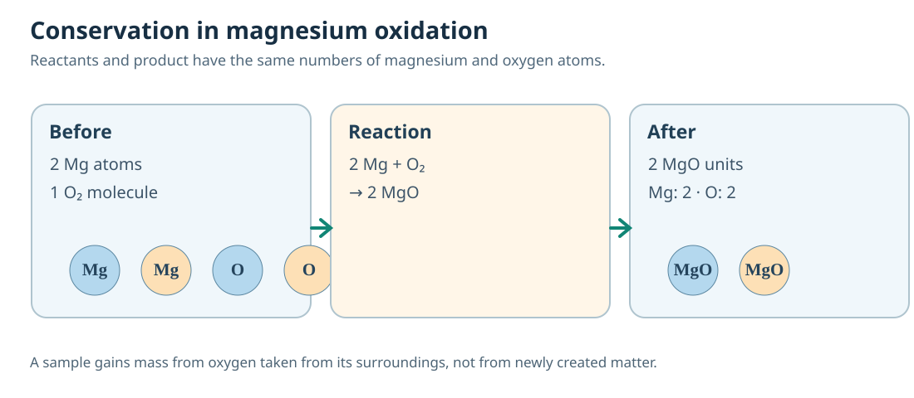

# C08 — Chemical Reactions and Energy
## A connected Core1A Chemistry textbook chapter · authored candidate v0.1.0

**DRAFT · ACADEMIC HOLD · SCIENTIFIC REVIEW PENDING · D3/D4 AUTHOR PROPOSALS · NOT A VERIFIED NSEJS PAPER.** Class X chemical reactions and equations provide the central curricular basis. Everything below is original teaching, not source-paper text. This chapter depends on Agent A atomic identity and formula concepts, whose independent pins remain pending.

A chemical equation is a compact representation of a material change, but a learner should never begin with a trick for balancing symbols. The scientific investigation starts with **what changes**, proceeds to **which species can account for the evidence**, and tests **which atoms, ions and energy flows remain conserved**. The six connected sections return to that same explanatory chain, building from combustion and crystallisation through precipitation, displacement and energy transfer to redox.

---

## C08.01 — Reading reaction evidence and balancing equations

### Investigate the phenomenon

A magnesium ribbon glows brightly, a white solid remains, and its mass seems to increase. Did matter appear from nowhere? The puzzling observation is precisely why a chemical equation must connect an experimental system to a particle account before it is used as a calculation.

### Build the scientific model

A chemical reaction changes the identities and arrangements of substances while preserving each chemical element in an ordinary chemical process. A colour, temperature, gas or precipitate change is evidence that merits investigation, but none alone guarantees a particular product. We first identify reactants and plausible products from observations and independent tests. Only after declaring the chemical species can we write a skeletal equation. Balancing comes last: numerical coefficients count reacting entities and never alter a molecule's subscripts.

Magnesium combines with oxygen to form magnesium oxide: 2Mg(s) + O₂(g) → 2MgO(s). Start with two Mg atoms and two O atoms on the left. The two formula units of MgO on the right contain the same totals. If the metal sample gains mass, the extra mass belongs to oxygen drawn from the air. A beaker or open crucible reading therefore describes an *open material system*, not proof that mass was created.

A balanced equation is not a photographic record of the reaction mechanism. It neither establishes reaction speed nor proves that the stated substances actually reacted. To move between experimental and particle representations, state the observation, a proposed species identity, the evidence for that identity, and the ledger of atom counts. Particle diagrams must carry exactly the same element inventory as symbols. In a closed system including the air that reacts, total mass remains conserved.

### Fully worked conceptual construction

Suppose a 2.4 g magnesium sample combines completely with 1.6 g oxygen from its surroundings. The closed-system product mass is 4.0 g. The open-crucible mass increase of 1.6 g is therefore evidence of oxygen uptake, not creation of new matter. Write 2Mg + O₂ → 2MgO. Confirm Mg: 2 → 2, O: 2 → 2. To check the proposal independently, verify that the residue is consistent with MgO rather than another white solid; mass conservation by itself cannot identify it.

### The wrong route and its repair

Changing MgO to MgO₂ just to balance the symbols changes the chemical species. Repair by leaving species formulas fixed and changing coefficients only.

### Boundary and independent scientific check

If some fine MgO smoke escapes, an open crucible can lose apparent mass even while oxygen is taken up. That cannot be diagnosed from the final mass alone; the experiment must control escaping product.

### The three Core1B demands

1. **EXPLAIN (D3 provisional)** — Explain why a burning magnesium ribbon can gain measured mass while total mass is conserved. Include the surroundings in your model.
2. **REPRESENT (D3 provisional)** — A particle sketch contains four Mg atoms and two O₂ molecules. Construct a balanced product sketch and symbolic reaction without changing molecular subscripts.
3. **SYNTHESIZE (D3 provisional)** — Two trials show a white solid after heating a metal; only one trial consumed oxygen. Can an identical solid colour establish identical reactions? Construct a two-stage evidence ledger.

---

## C08.02 — Combination, decomposition and the role of conditions

### Investigate the phenomenon

A substance turns from blue crystals to a pale powder when heated. Another substance turns from a white solid to a different white solid and releases gas. Both lose mass, but are they undergoing the same kind of chemical change?

### Build the scientific model

A combination reaction creates one principal product from two or more reactants, whereas decomposition splits a compound into simpler products. The word *principal* matters: real experiments may include side reactions, dissolved species and energy transfer. The types are descriptions of the net chemical equation, not proof of mechanism. For example, 2H₂(g) + O₂(g) → 2H₂O(l) combines elements, while CaCO₃(s) → CaO(s) + CO₂(g) decomposes a compound when sufficient energy is supplied.

Heating is a condition, not a reaction classification. A solid that melts changes physical state while retaining the same chemical identity. Hydrated copper sulfate can lose its water of crystallisation and change colour, yet interpreting the process correctly requires identifying the hydrated solid, remaining solid and released water. Temperature, light and electric current may initiate different decompositions. An explanation must distinguish energy input from chemical bond rearrangement and specify evidence for new species.

A useful three-layer picture places apparatus observations above formulas and particle counts. In a decomposition, the starting compound's atoms must be distributed among product species. In a combination, each reactant contributes atoms to the product. The same mass-conservation check applies to both directions, but energy absorbed or released is a separate account. In class demonstrations, change only one controlled variable at a time: temperature, light exposure or moisture.

### Fully worked conceptual construction

A sample of calcium carbonate is heated strongly and gives a residue plus a gas. A plausible equation is CaCO₃ → CaO + CO₂. It balances Ca 1, C 1, and O 3 on each side. A measured loss of 4.4 g from an initially 10.0 g closed composition would correspond to 4.4 g gas leaving an *open* apparatus if no other loss occurs; 5.6 g would remain. But that mass pattern alone cannot prove the gas was CO₂; a suitable independent test is needed.

### The wrong route and its repair

'Anything heated decomposes' confuses a physical trigger with proof of a change in chemical identity. Repair by comparing material before and after, and by using species and gas tests.

### Boundary and independent scientific check

Water evaporating from a salt solution is not decomposition of sodium chloride. In contrast, heating certain compounds breaks them into chemically new substances. The gas source and residue composition decide.

### The three Core1B demands

1. **EXPLAIN (D3 provisional)** — Explain why melting ice and thermal decomposition of CaCO₃ must be classified differently even though both need energy.
2. **REPRESENT (D3 provisional)** — Draw a particle conservation ledger for 2H₂ + O₂ → 2H₂O and contrast it with CaCO₃ → CaO + CO₂.
3. **SYNTHESIZE (D3 provisional)** — A heated blue solid loses water and turns pale, while a different sample produces a gas that clouds limewater. Synthesize observations that distinguish dehydration and carbonate decomposition.

---

## C08.03 — Displacement and ion exchange

### Investigate the phenomenon

A zinc strip placed in blue copper sulfate solution develops a reddish deposit, but a copper strip in zinc sulfate does not show the same result. What does this asymmetry reveal?

### Build the scientific model

In simple metal displacement, a more reactive metal may replace a less reactive metal from its dissolved salt under suitable conditions. Zinc atoms are oxidised to Zn²⁺ while Cu²⁺ ions gain electrons and deposit as copper. The ionic description Zn(s) + Cu²⁺(aq) → Zn²⁺(aq) + Cu(s) makes the exchange visible. Sulfate is a spectator ion. The observation is chemical evidence for this particular pairing, not a licence to claim every metal behaves identically.

Double displacement is a different kind of species rearrangement in solution: the ions from two ionic solutions can exchange partners. A visible precipitate, formation of water, or release of gas can make the net reaction evident. However, merely writing exchanged formulas does not guarantee a reaction occurs. Some proposed combinations leave all ions dissolved and lead to no net ionic change. Solubility and the actual conditions must be checked.

Both classes require careful representation. Draw dissolved ions individually, not as floating 'NaCl molecules' in ordinary dilute solution. For metal displacement, the solid strip and dissolved cation represent distinct states, and charge/electron accounting explains why a metal deposits. For ion exchange, draw spectator ions before and after and explain what particle-level event removes particular ions from solution.

### Fully worked conceptual construction

Iron placed into CuSO₄ solution may follow Fe + CuSO₄ → FeSO₄ + Cu. The ions can be reduced to Fe(s) + Cu²⁺(aq) → Fe²⁺(aq) + Cu(s). Charge on each side is +2, and one iron and one copper remain accounted for. If a copper strip does not displace iron from FeSO₄ under comparable conditions, this supports Fe being above Cu in the reactivity order for the tested setting. It does not establish reactivity relative to all other metals.

### The wrong route and its repair

'Swap ions or metals in an equation and a reaction must occur' confuses a formal writing operation with chemical feasibility. Repair by checking observed species, energy/reactivity conditions, soluble products and controls.

### Boundary and independent scientific check

A metal might be blocked by a protective surface oxide, so a single negative displacement observation may not justify a complete reactivity ordering. Repeat with a cleaned strip and controlled solution.

### The three Core1B demands

1. **EXPLAIN (D3 provisional)** — Explain why Zn deposits copper from CuSO₄ but Cu ordinarily does not displace zinc from ZnSO₄.
2. **REPRESENT (D3 provisional)** — Translate Fe(s) + CuSO₄(aq) → FeSO₄(aq) + Cu(s) into a net ionic equation and identify spectators.
3. **SYNTHESIZE (D3 provisional)** — A salt solution becomes cloudy after two clear solutions mix. Distinguish a true precipitation-driven double displacement from ions merely mixing; propose two confirming observations.

---

## C08.04 — Precipitation: what a cloudy mixture does and does not prove

### Investigate the phenomenon

Two completely clear solutions can yield a white solid in seconds. The striking colour change is real, but how can the experiment establish which ions have combined?

### Build the scientific model

A precipitation reaction forms an insoluble or sparingly soluble solid from dissolved species. For example, mixing aqueous barium chloride and sodium sulfate can form barium sulfate: BaCl₂(aq) + Na₂SO₄(aq) → BaSO₄(s) + 2NaCl(aq). The net ionic process is Ba²⁺(aq) + SO₄²⁻(aq) → BaSO₄(s). Sodium and chloride ions stay dissolved and are not constituents of the precipitate. The equation conveys a particle account, not merely a memorised visual result.

A white cloud may also arise from suspended dust, bubbles, a colloid or another sparingly soluble substance. A student's scientific explanation must therefore separate observation ('the mixture became cloudy') from interpretation ('BaSO₄ formed'). Proper tests include filtering, identifying the residue, performing reagent blanks and checking whether the expected ions are consumed. The absence of a visible precipitate is also not absolute proof that a small amount of product did not form.

At D3/D4 depth, predict the outcome from species identities, appropriate solubility information and charge balance, then reconcile it with contradictory evidence. Do not use a colour table alone to guess. Charge bookkeeping and atom conservation constrain a plausible equation; independently obtained solubility and species evidence justify the proposed reaction.

### Fully worked conceptual construction

Start with 1 unit of BaCl₂ and 1 unit of Na₂SO₄. The inputs contain one Ba, two Cl, two Na, one S and four O. The right side BaSO₄ + 2NaCl preserves every atom. In the dissolved-ion account the Ba²⁺ and SO₄²⁻ disappear into an insoluble solid while Na⁺ and Cl⁻ remain. If an experimental sample contains excess sodium sulfate, it can remain dissolved after all Ba²⁺ is consumed. A second sulfate addition may therefore produce no further precipitate.

### The wrong route and its repair

'The precipitate is NaCl because sodium and chlorine are present' ignores solubility and ionic species. Repair by writing dissociated ions and marking the actual insoluble product.

### Boundary and independent scientific check

A solution already saturated with other dissolved salts can alter precipitation behavior; do not extend a simplified solubility prediction to all concentrations and temperatures without stating assumptions.

### The three Core1B demands

1. **EXPLAIN (D3 provisional)** — Explain how mixing BaCl₂(aq) and Na₂SO₄(aq) yields a solid while sodium and chloride remain dissolved.
2. **REPRESENT (D3 provisional)** — Represent the BaCl₂/Na₂SO₄ reaction using before-and-after ion inventories and identify net ionic versus spectator species.
3. **SYNTHESIZE (D3 provisional)** — Two mixed solutions become milky but the expected sulfate test is negative. Synthesize two rival explanations and design a discriminating experiment.

---

## C08.05 — Reaction energy: system and surroundings

### Investigate the phenomenon

A beaker becomes warm when quicklime meets water, yet some reactions absorb heat and still proceed. Is the thermometer measuring 'how much energy is in the chemicals'?

### Build the scientific model

An exothermic process transfers energy from the reacting system to its surroundings, while an endothermic process absorbs energy under the stated conditions. The words describe net energy exchange, not the numerical temperature of a substance. A thermometer measures the local sample or surroundings after heat transfer; its reading can also depend on mixing, evaporation, container heat capacity and loss to the air. Always name the system boundary before deciding the sign.

For a familiar example, CaO(s) + H₂O(l) → Ca(OH)₂ with heat released to surroundings under ordinary conditions. Heating calcium carbonate so it decomposes to CaO and CO₂ requires energy input. An energy-profile diagram must distinguish the energy difference between reactants and products from the activation barrier. An exothermic reaction can still need an ignition or initiation step because a barrier must be crossed first.

At D3, explain the causal path from bonds breaking/forming to net transfer without claiming that breaking chemical bonds itself releases energy: breaking requires input, while bond formation releases energy. At D4, compare competing processes that give the same temperature change and explain what controlled calorimetry or heat-loss correction would establish. A single warm beaker does not prove a unique reaction mechanism.

### Fully worked conceptual construction

A reaction releases 500 J into a calorimeter containing 100 g of water, assuming no heat loss and using c = 4.18 J/(g·°C). The ideal temperature rise would be ΔT = 500/(100×4.18) ≈ 1.20 °C. The small rise does not imply a small reaction *activation energy*: those are different quantities. If the actual rise is only 0.9 °C, heat absorbed by the vessel or loss to air may explain the difference; the original release cannot be recovered without accounting for apparatus heat capacity.

### The wrong route and its repair

'If a reaction has an activation barrier, it must absorb energy overall' mixes energy required to start with the net energy difference. Repair by drawing reactants, barrier peak and products separately.

### Boundary and independent scientific check

A chilled beaker can temporarily feel cold even during an exothermic reaction if the net heat-flow environment is complicated. Controlled energy accounting, not touch, determines the thermochemical claim.

### The three Core1B demands

1. **EXPLAIN (D3 provisional)** — Explain why an exothermic reaction can need initial heating before it starts and why the vessel may warm afterward.
2. **REPRESENT (D3 provisional)** — Construct paired energy profiles for CaO hydration and CaCO₃ decomposition, labelling reactants, products and activation barriers.
3. **SYNTHESIZE (D3 provisional)** — A recorded beaker temperature falls during a process believed exothermic. Build competing energy-flow models and identify the additional measurements needed.

---

## C08.06 — Oxidation and reduction as a paired transformation

### Investigate the phenomenon

Black copper oxide becomes reddish copper when hydrogen passes over a heated sample. Where did the oxygen go, and did only one chemical species change?

### Build the scientific model

In school-level oxygen-transfer language, oxidation may mean oxygen gain while reduction means oxygen loss. They are not separate unrelated labels but two aspects of an overall redox process. For CuO + H₂ → Cu + H₂O, copper oxide loses oxygen and is reduced to copper. Hydrogen gains oxygen to become water and is oxidised. The atoms do not disappear: oxygen transfers to a different chemical species. This is a stronger explanation than 'the black substance turned red'.

Not every oxidation involves molecular oxygen gas. At higher conceptual depth, electron transfer and formal oxidation states generalise the paired change, but the simple oxygen-transfer model is appropriate when the participating species make that transfer explicit. Avoid declaring every colour change redox. A colour change may accompany complex formation, acid/base indicators or physical changes without an oxidation-state change.

The representation bridge is crucial: show CuO and H₂ as initial species, then the Cu and H₂O as final species, checking one Cu, one O and two H atoms on both sides. Distinguish an observed solid-colour change from confirmation of the gaseous or condensed product. At D3/D4 level, a reviewer must ask for independent tests and reject claims of a unique reaction from insufficient observations.

### Fully worked conceptual construction

Suppose CuO is reduced under suitable controlled conditions with H₂. Write CuO + H₂ → Cu + H₂O. Confirm O 1 → 1 and H 2 → 2. Use the oxygen-accounting model: CuO loses O, so CuO is reduced; H₂ gains O, so H₂ is oxidised. Under an electron-accounting model, Cu²⁺ in CuO goes to Cu⁰ and hydrogen goes from oxidation state 0 to +1 in water; this is an optional bridge to C13, not an assumption about an experimentally resolved mechanism.

### The wrong route and its repair

'Hydrogen is the reducing agent, therefore hydrogen is reduced' confuses an agent's effect on another species with its own change. Repair: name the species that gains/loses oxygen, then describe its own oxidation/reduction.

### Boundary and independent scientific check

A metal oxide might turn reddish due to a different chemical mixture or lighting; neither colour nor one balanced hypothetical equation uniquely identifies the products. Confirm species and conditions.

### The three Core1B demands

1. **EXPLAIN (D3 provisional)** — Explain which species are oxidised and reduced when CuO reacts with hydrogen, using oxygen transfer rather than keyword matching.
2. **REPRESENT (D3 provisional)** — Represent CuO + H₂ → Cu + H₂O as an atom ledger and an oxygen-transfer diagram, identifying oxidant and reductant.
3. **SYNTHESIZE (D3 provisional)** — A black solid becomes red after heating in a gas flow. Synthesize evidence needed to decide whether CuO reduction occurred or a different change caused the colour.

---

## Chapter synthesis and verification

The common scientific ledger is **evidence → species and conditions → particle or ionic representation → balanced symbolic change → independent check**. That ledger helps distinguish a mass gain in an open crucible from mass creation, physical heating from decomposition, a formal ion swap from a true precipitate, and a warm thermometer from the thermochemical energy of a defined system. An equation that balances atoms is necessary for a plausible ordinary chemical reaction, but it is not sufficient to prove that reaction occurred or that one laboratory observation uniquely identifies the products.

**Source and review custody:** IAPT NSEJS 2026 accepts Chemistry up to Class X; CBSE 2026–27 Science Class X Chemical Reactions and Equations; Agent A source register `chemistry-syllabus.v1.json@0.1.0`. All tasks are explicitly AUTHORED_PRACTICE. Exact NCERT edition/page and independent Chemistry review pending; no exam-question verification, release or deployment claim.
