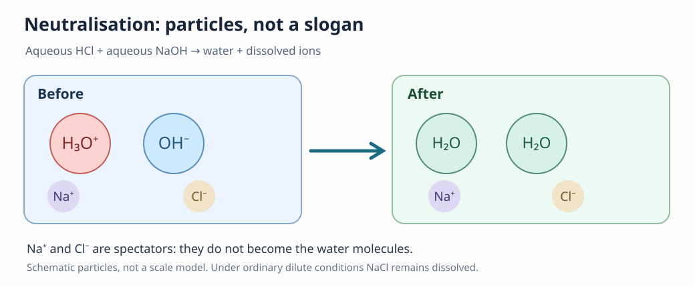
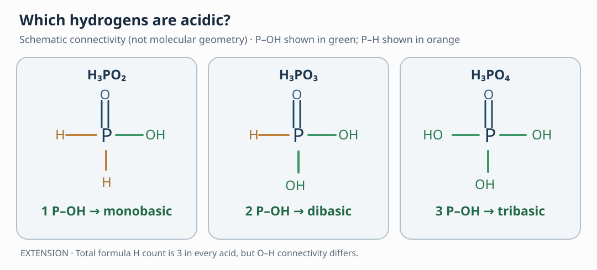

# C09 — Acids, Bases, Salts and Oxyacids
## Core1A textbook-first manuscript · Agent B candidate R1

**Audience:** independent Grade 9–10 NSEJS learner. **Status:** DRAFT, SCIENTIFIC/ACADEMIC HOLD. **C09.06:** EXTENSION; not compulsory CBSE Class X. This is *authored textbook teaching*, **not** a reproduced NSEJS question, publisher key or official paper.

**Curricular scope:** C09.01–C09.05 align to the CBSE Class X "Acids, Bases and Salts" substance boundary. C09.06 goes beyond school acid/base basics and is explicitly marked EXTENSION. The canonical source framework is Agent A's Stage0 PR #1; independent paragraph-level textbook/edition review remains pending.

### A question to carry through the chapter

Why does a dry substance sometimes show no acid-like indicator effect, yet the same substance in water turns an indicator red? Why can two colourless solutions produce water and a salt, and still leave the mixture acidic? These questions do not begin with an exam answer: they force us to distinguish **substances**, **what happens to them in water**, **which ions react**, and **what observations can truly establish**.

Read the sections in order. At every stage, compare **macroscopic evidence** (colour, temperature, gas) with **particles in water** (ions, molecules) and **symbols** (formulae, balanced equations). A symbol is a model, not direct experimental proof.

---

## C09.01 — Acids, bases, aqueous ions and indicators (CORE CANDIDATE)

### 1. Why water matters

An acid is not simply "a liquid that turns litmus red." For the Class X aqueous model, the decisive chemical property is the increase of hydrogen-ion availability in water. Free bare H+ is not normally an isolated stable species in water; it is hydrated, often represented in school texts as H+(aq) and more explicitly as H3O+(aq). A base such as sodium hydroxide releases hydroxide ions into water. Another substance may behave as a base by reacting with water to generate OH−. These definitions are useful within their stated aqueous scope; they should not be silently extended to every gas or nonaqueous medium.

Hydrogen chloride can exist as HCl(g). Properly *dry* HCl gas does not turn *dry* blue litmus paper red in the standard school demonstration. When it encounters water, its ionisation is represented as:

HCl + H2O → H3O+ + Cl−.

The colour change of moist blue litmus is an effect of that aqueous environment. The paper's moisture is therefore an experimental variable, not a trivial setup detail. Never deliberately inhale the gas or perform this experiment without laboratory supervision.

### 2. Indicators report a range, not a chemical identity

Litmus is a useful qualitative acid/base indicator: acidic solutions turn blue litmus red; basic solutions turn red litmus blue. Phenolphthalein is colourless in acidic/near-neutral conditions and pink in sufficiently basic conditions; methyl orange has a different transition interval. Universal indicator gives a broader colour scale, but colours vary with concentration, medium and reading conditions. An indicator alone cannot identify the exact acid or base, its molarity, or whether an acid is chemically "strong."

**Strong versus concentrated:** "strong" concerns the extent of acid dissociation under specified conditions; "concentrated" concerns how much solute is present in the solution. A dilute strong acid and a concentrated weak acid are different comparisons. A colour observation often cannot separate them.

### 3. Worked construction — the dry and wet tests

Observation: A dry sample of blue litmus near a stream of dry HCl remains blue, while a moistened strip turns red. First identify the controlled change: water availability. Then select the aqueous ion model: HCl has access to water and hydronium forms. Next connect indicator colour to acidity in the *wet* strip. Finally test the rival claim "HCl is not an acid when dry": that wording confuses intrinsic potential acid behaviour with the **aqueous indicator test** used. The more precise conclusion is that the observed colour change depends on the aqueous medium.

**Three independent demands:** EXPLAIN the cause of the differing tests; MODEL the medium-dependent state and alternative explanations; JUSTIFY which chemical claims the observations do and do not prove.

**Typical wrong path:** "Anything that turns blue litmus red is definitely hydrochloric acid." Repair: indicator colour shows a property, not unique identity. **Independent check:** use a second indicator and a blank damp-paper control, and explicitly distinguish indicator inference from chemical identification.

---

## C09.02 — Neutralisation, salt formation and what remains (CORE CANDIDATE)

### 1. The particles, not just the slogan

When hydrochloric acid and sodium hydroxide mix in water, the central neutralisation is:

H3O+ + OH− → 2H2O.

Meanwhile Na+ and Cl− remain in solution. The complete molecular-form school equation is:

HCl(aq) + NaOH(aq) → NaCl(aq) + H2O(l).

Both representations have a job. The molecular equation identifies reactants and products; the ionic account shows what changes and which ions are spectators. Do not describe NaCl(aq) as a precipitate of table-salt molecules: in this context it remains dissolved as ions.

### 2. Why neutralisation does not automatically mean neutral pH

The ratio matters. A small amount of base added to a large amount of acid may consume only *some* available hydronium; the mixture remains acidic. Conversely, excess base leaves a basic solution. Even at a stoichiometric equivalence point, not every weak-acid/weak-base salt solution is pH 7; salt hydrolysis may matter (advanced boundary). Thus "acid + base → salt + water" is a reaction pattern, not a theorem that every mixed sample becomes neutral.

### 3. Worked construction — excess reactant

Suppose equal-concentration aqueous HCl and NaOH samples are mixed, but the acid volume is twice the base volume. Assume both are fully dissociated and both are sufficiently dilute that volume additivity is a reasonable school approximation. Equal concentrations mean equal amounts per unit volume. Twice as much acid solution therefore initially contains twice as many acid equivalents; hydroxide neutralises only half the hydronium equivalents. **Acid remains**. For a numerical bridge: 20 mL of 0.10 mol/L HCl is 2.0 mmol HCl, while 10 mL of 0.10 mol/L NaOH is 1.0 mmol NaOH; 1.0 mmol acid-equivalent remains. The arithmetic is optional higher-depth practice, not a required Class X logarithmic pH calculation.

**Three demands:** EXPLAIN neutralisation at particle level; MODEL limiting/excess ionic species; JUSTIFY why a near-neutral indicator or a balanced equation alone does not establish the salt's identity.

**Typical wrong path:** "Both reagents are present, therefore all acid is gone." Repair: build the reactant amount ledger first. **Independent check:** atom, charge and excess-reactant conservation; try reversing the volumes.

---

## C09.03 — pH, dilution and everyday use (CORE CANDIDATE)

### 1. Interpreting pH without treating it as a memorised colour strip

The school-level pH scale orders aqueous solutions by acidity. Under ordinary dilute aqueous conditions at about 25 °C, pH below 7 is acidic, 7 is neutral, and above 7 is basic. A smaller pH is associated with greater hydronium activity. At higher depth, pH uses a logarithmic scale, but the CBSE Class X specification explicitly does **not** require derivation of the logarithmic definition. We can compare trends and evidence before quantitative extensions.

Why does dilution generally make a simple acid solution less acidic? When water is added without adding more acid, the acid-derived hydronium becomes distributed through a larger volume. Other chemical equilibria can complicate exact quantitative predictions, so we should predict the **direction** confidently under standard assumptions without claiming an unsupported fixed change in pH.

### 2. The natural world is not always neutral

Acidic stomach contents help digestion, while excess acidity can cause discomfort. Tooth enamel is vulnerable when mouth pH falls sufficiently; local conditions and duration matter. Soil and aquatic life respond to pH ranges rather than one magic safe number. Distinguish a measured pH from a diagnosis or an environmental cause: you need contextual evidence.

### 3. Worked construction — dilution and uncertain readings

A sample measures pH 3 before dilution and later measures pH 4.5 with a correctly calibrated instrument. First infer direction: acidity has decreased. Second refuse an overclaim: the two pH readings alone do not identify the acid or its total amount. Third inspect controls: same temperature, calibrated instrument, and no reactive additions. If different indicators disagree, compare their transition ranges and the conditions rather than forcing one colour to be "the answer."

**Three demands:** EXPLAIN acidity and dilution; MODEL a changed-condition solution using measurements; JUSTIFY why pH alone cannot reveal exact solute identity.

**Typical wrong path:** "Add enough water and all acid is chemically neutralised." Repair: dilution lowers concentration without consuming acid species by neutralisation. **Independent check:** reverse the intervention by comparing actual added acid/base amount, not colour alone.

---

## C09.04 — Common salts: compositions, preparations and uses (CORE CANDIDATE)

### 1. Common names conceal different chemistry

**Caustic soda** is sodium hydroxide, NaOH, an alkali and important industrial raw material. Industrial electrolysis of aqueous sodium chloride (the chlor-alkali process) produces NaOH, hydrogen and chlorine under controlled conditions:

2NaCl(aq) + 2H2O(l) → 2NaOH(aq) + H2(g) + Cl2(g).

The hazardous gases and caustic chemicals make this an **industrial description, not a home experiment**.

**Baking soda** is sodium hydrogen carbonate, NaHCO3. On heating it can form sodium carbonate, water and carbon dioxide:

2NaHCO3 → Na2CO3 + CO2 + H2O.

Its reaction with acidic ingredients releases CO2, important in baking. **Washing soda** is hydrated sodium carbonate, conventionally Na2CO3·10H2O. The two are not interchangeable just because both contain sodium and carbonate-related ions. Hydration water is part of the crystal composition and must not be confused with a change in sodium-carbonate identity.

**Bleaching powder** is often represented at school level by the empirical idealised formula CaOCl2 and is made using chlorine and dry slaked lime. Commercial bleaching-powder material is more complicated than a collection of pure discrete "CaOCl2 molecules"; do not claim molecular purity from the school shorthand. Its applications depend on oxidising available chlorine, handled only with suitable precautions.

**Gypsum** is CaSO4·2H2O. Heating under controlled conditions yields **Plaster of Paris**, often written CaSO4·1/2H2O. Adding water allows the plaster to set through rehydration. The fractional hydration notation records the average composition of the calcium sulfate hemihydrate, not half a standalone water molecule moving independently through the solid.

### 2. Worked construction — hydrate accounting

Compare the idealised formulas CaSO4·2H2O and CaSO4·1/2H2O. Each retains one calcium, one sulfur and four sulfate oxygen atoms. The difference is 1.5 water molecules *per CaSO4 formula unit* in the stoichiometric description. To avoid half molecules, write the dehydration stoichiometry on two formula units:

2(CaSO4·2H2O) → 2(CaSO4·1/2H2O) + 3H2O.

Confirm the number of water-related H and O atoms on both sides. This is a material balance model, not an industrial recipe.

**Three demands:** EXPLAIN preparation/use differences; MODEL a plausible transformation or identification test; JUSTIFY why one observation cannot uniquely identify a common white powder.

**Typical wrong path:** "All white sodium powders are one salt" or "a commercial product formula proves purity." Repair: check anions, hydrate states and controls. **Independent check:** balance equations and identify at least one discriminating chemical observation.

---

## C09.05 — Acids with metals and carbonates: identify the gas (CORE CANDIDATE)

### 1. Two forms of bubbling, two different products

Zinc reacts with **dilute nonoxidising** hydrochloric acid to liberate hydrogen under suitable conditions:

Zn(s) + 2HCl(aq) → ZnCl2(aq) + H2(g).

Calcium carbonate reacts with hydrochloric acid to liberate carbon dioxide:

CaCO3(s) + 2HCl(aq) → CaCl2(aq) + H2O(l) + CO2(g).

The shared macroscopic observation is bubbling. That is insufficient to identify the gas. The reacting solid, chemical species and confirmatory test distinguish the two pathways.

In a supervised laboratory, hydrogen may give a characteristic pop with a tiny collected sample near a flame; because it is flammable, **never** propose this as an unsupervised home activity. Carbon dioxide turns clear limewater milky through calcium carbonate precipitation:

Ca(OH)2 + CO2 → CaCO3(s) + H2O.

Excess CO2 may subsequently dissolve the precipitate by forming soluble hydrogen carbonate under the right conditions, so the full observations and gas amount matter.

### 2. Boundary of the rule

Not every metal displaces hydrogen from every acid. Copper does not ordinarily liberate H2 from dilute hydrochloric acid. An **oxidising acid** such as nitric acid may give different reduction products rather than the familiar hydrogen reaction, depending on conditions. The useful rule is a conditional model, not a universal gas-output formula.

### 3. Worked construction — identify an unknown

Two unknown solid samples separately effervesce on addition of dilute acid. Only one gas turns fresh limewater milky. Infer that the second observation supports a CO2-forming pathway, consistent with an acid/carbonate or acid/hydrogen carbonate reaction. But it does **not** uniquely identify the precise carbonate compound. To identify the original solid, further controlled composition tests are needed. The other gas cannot automatically be called hydrogen without a suitable confirmatory test.

**Three demands:** EXPLAIN the different particle transformations; MODEL an experimental discriminator; JUSTIFY the limits of gas identity and compound inference.

**Typical wrong path:** "Bubbles mean hydrogen." Repair: separate reaction-type prediction from gas confirmation. **Independent check:** balance the candidate equations and test whether the same observation could have another chemical cause.

---

## C09.06 — Phosphorus oxyacids and structural basicity (EXTENSION)

**This section is clearly beyond ordinary Class X acid/base core.** It is included because the existing NSEJS-oriented authored material specifically raises a structural reasoning challenge. This chapter does not imply that detailed phosphorus oxyacid chemistry is compulsory for NSEJS.

### 1. Why molecular formula is insufficient

Three compounds can all have three hydrogen atoms in their formula yet have different numbers of acid-ionisable protons:

| Acid | Structural shorthand | P–OH units | Structural basicity |
|---|---|---:|---:|
| H3PO2 (hypophosphorous / phosphinic acid) | H2P(=O)–OH | 1 | Monobasic |
| H3PO3 (phosphorous / phosphonic acid) | HP(=O)(OH)2 | 2 | Dibasic |
| H3PO4 (phosphoric acid) | P(=O)(OH)3 | 3 | Tribasic |

The decisive connection is **which hydrogens are attached to oxygen** (P–OH) rather than to phosphorus (P–H). In the standard structural acid-base account, P–H hydrogen is not an ionisable proton of the same kind as O–H hydrogen. Different structural arrangements are required even though all three molecular formulas show H3.

### 2. Building, not memorising, the result

For H3PO3, draw a P=O group, two P–OH groups and one P–H. Count hydrogen atoms: two from O–H and one directly attached to phosphorus, totalling three. Then count acid-dissociable O–H units: two. So it is **dibasic**, not tribasic. Run the same procedure for H3PO2 and H3PO4. This method explains the answer rather than offering a formula trick.

### 3. An advanced distinction

Phosphorus oxyacids containing P–H bonds can have reducing behaviour; structural basicity and redox activity are therefore **different properties**. Do not infer one from the other solely from molecular hydrogen count. The detailed electronic explanations and acid dissociation constants are advanced additions requiring their own academic review.

**Three demands:** EXPLAIN the structural distinction between P–OH and P–H; MODEL the molecular connectivity from constrained information; JUSTIFY why the same H3 total does not imply equal basicity.

**Typical wrong path:** "H3 means three acidic H" or "the number of P–H bonds equals basicity." Repair: reconstruct the actual O–H connections. **Independent check:** count all atoms in the structural shorthand and count P–OH groups independently.

---

## Chapter-level concept map, not an answer-key map

**Water and ion availability → acid/base observable behaviour → particle-level neutralisation → pH and dilution → composition/uses of salts → gas-producing acid reactions → EXTENSION structural acid basicity.**

Each section introduces a real phenomenon, an appropriate model, a connected explanation, a completed worked construction, a wrong route, a repair and an independent test. Its three target QRT operations are anchored to the same scientific truth but require **different learner work**. The corresponding Core1B reconstruction exercises live in \`C09.core1b.v0.1.0.json\`. This textbook is the teaching source; those tasks do not retroactively certify original exam-question keys.

### Curriculum / source custody and review

- IAPT NSEJS: https://iapt.org.in/ (official examination scope up to CBSE Class X).
- CBSE Science Class X 2026–27: https://cbseacademic.nic.in/web_material/CurriculumMain27/SecPart1/Science_SecP1_2026-27.pdf
- Agent A Stage 0/1 syllabus and shared contracts pinned to PR #1 \`77d2bd63328c184598088bce6b9888fc8324cb4b\`.
- Historic phosphorus oxyacid source-derived preview remains separate and unmodified. Any reproduced original paper text, key or figure must pass its own source custody.

**Status: WRITTEN CANDIDATE — NOT INDEPENDENTLY SCIENTIFICALLY REVIEWED — NO CORE2 SOURCE ADMISSION — NO PUBLIC LEARNER RELEASE.**
