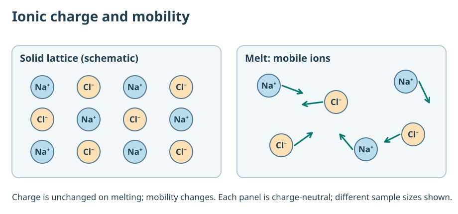

# C10 — Metals, Non-metals and Metallurgy
## Connected Core1A textbook chapter · author candidate · NOT ACADEMICALLY RELEASED

**Scope:** CBSE Class X metal/nonmetal properties, relative reactivity, ionic compounds, basic metallurgical methods, corrosion. **Prerequisite:** Agent A C05–C07 draft chemistry concepts and C08 reaction fundamentals. The fully qualified canonical concept identifiers remain a separate handoff. **Status:** WRITTEN / INDEPENDENT SCIENTIFIC REVIEW PENDING; author-written examples are not original NSEJS questions.

A useful metal/non-metal lesson does not begin by reciting the reactivity series. It begins by asking what observations require explanation, what particles can carry charge or undergo electron transfer, and which chemical conditions make an inference valid. The six linked sections move from physical evidence through displacement and ionic solids to extraction chemistry, amphoterism and electrochemical corrosion.

---

## C10.01 — Properties and their exceptions

### The phenomenon

A pencil lead conducts electricity, whereas a crystalline salt often does not while solid. If conductivity alone identified a metal, graphite would become a metal. The contradiction is a useful entry into particle-level explanation.

### Build and test the scientific explanation

Most metals are lustrous, malleable and conduct heat and electricity because electrons can move through the solid metallic structure. By contrast, many non-metals form molecular or covalent-network solids whose electrons are not mobile in the same way. Those are trends, not definitions. Graphite has mobile electrons within its layers although it is carbon; iodine is lustrous but not a metal; mercury is a liquid metal at room temperature. Classification must combine identity, bonding and several observations.

A material's conductivity depends on available mobile charge carriers. In metals, mobile electrons carry charge through a solid. In a solid ionic salt, ions are present but locked into positions in the crystal; on melting or dissolving in water, suitable ions become mobile. In graphite, delocalised electrons move within layered carbon networks. The same macroscopic reading can have different particle explanations, so conductivity alone does not reveal a unique bonding model.

At an Olympiad-level evidence table, compare lustre, brittleness, melting behaviour, conductivity of the dry solid and conductivity after melting or dissolution. The correct task is to construct and reject models under stated conditions. Do not infer metallic identity from a single observation, and do not expect one classroom property to classify all elements without exceptions.

### Fully worked conceptual example

A black solid conducts as a solid, breaks into flakes and is chemically identified as elemental carbon. Its conduction is compatible with graphite and electron mobility in layers; the sample is not a metal just because the meter registers a current. Distinguish this from NaCl(s), which ordinarily does not conduct but does when molten because the ions move. The comparison explains *mechanism*, not just names.

### Misconception and repair

Wrong path: 'anything shiny or electrically conducting is a metal.' Repair: test multiple properties and identify the actual charge carriers instead of treating appearance as a definition.

### Changed-condition boundary

If a carbon sample fails a conductivity check due to poor electrical contacts, the negative measurement does not prove it is diamond. Recalibrate apparatus and test another physical/chemical property.

### Independent reconstruction targets

1. **EXPLAIN, D3 candidate** — Explain why copper wire and graphite each conduct electricity but must not be treated as one chemical class.
2. **MODEL, D3 candidate** — A shiny, brittle, conducting black sample is labelled 'metal' by one student. Choose a model and design two tests that discriminate graphite from a metal.
3. **SYNTHESIZE, D3 candidate** — A dry solid does not conduct, its melt conducts, and its aqueous solution also conducts. Synthesize a likely ionic explanation and a counterexample to unique identification.

---

### B02 scientific reasoning refinement

Mobile charge carriers may be electrons or ions; graphite is a nonmetal with anisotropic electronic conduction. Ionic lattices usually have immobile ions; dissolved or molten ions may carry current. Conductivity alone cannot identify a material; control contacts, geometry and phase.

**Independent transfer target (MODEL, D3 author proposal):** Compare carrier models, directional and phase evidence, and distinguish consistency from identification.. The fresh task and worked answer remain in Core1B. Independent source and QRT review HOLD.

### B02 additional scientific foundations

Conductivity is a macroscopic response; a mechanism must identify a mobile charge carrier and the structure permitting its motion. Direction and physical state help discriminate the models.

The same final species can result from dissociation or chemical ionisation. A state change, dissolution and reaction are distinct processes; a final measurement does not always reconstruct initial identity.

## C10.02 — Metal reactivity and displacement evidence

### The phenomenon

Place zinc into blue copper sulfate solution and watch copper appear. Reverse the solids and solutions, and the reaction disappears under ordinary conditions. Instead of memorising a ladder, ask which observations constrain a pairwise tendency.

### Build and test the scientific explanation

The metal reactivity series summarises comparative chemical tendencies in familiar aqueous displacement and other reactions. Zinc can reduce aqueous Cu²⁺ to copper while becoming Zn²⁺: Zn(s) + Cu²⁺(aq) → Zn²⁺(aq) + Cu(s). In a simple comparison, zinc is more reactive than copper. The solution's anion may be a spectator, but the reactivity claim applies under controlled conditions. An exchange written on paper does not establish spontaneity.

A reactivity order can be built from directed evidence. Suppose A displaces B²⁺, and B displaces C²⁺ under comparable conditions. Then the observations support A > B > C for the tested displacement behaviour. They do not specify exact reaction rates, nor how A compares with a fourth untested metal D. Displacement arrows must be grounded in observations with identified deposits and controlled reagents.

An unreactive-looking strip may be covered by an oxide layer. Aluminium's protective oxide film can mask rapid metal reactivity in one experiment. Temperature, concentration and surface preparation therefore change what a negative observation means. Treat all negative evidence with a documented sensitivity check, not as a universal theorem.

### Fully worked conceptual example

Three tests give Zn + CuSO₄ → ZnSO₄ + Cu, Fe + CuSO₄ → FeSO₄ + Cu, and no clear deposit for Fe in ZnSO₄. They support both Zn > Cu and Fe > Cu; a clean, comparable Fe/Zn comparison could provide Zn > Fe. On those conditions Zn > Fe > Cu is plausible, but the original two positive tests alone do not establish Zn versus Fe. State which inference is directly observed and which requires another comparison.

### Misconception and repair

Wrong path: 'no deposit means the metal is less reactive.' Repair: control surface oxide, reagent age, temperature and concentration, then repeat before ordering.

### Changed-condition boundary

If Zn is passivated, a result may contradict the simple expectation. A model must distinguish chemical tendency from an observation masked by kinetics or surface barriers.

### Independent reconstruction targets

1. **EXPLAIN, D3 candidate** — Explain the electron and species changes when Zn replaces Cu from CuSO₄ solution.
2. **MODEL, D3 candidate** — Tests show A displaces B and B displaces C; no A/C test was performed. Choose a justified order and name the conditions under which it holds.
3. **SYNTHESIZE, D3 candidate** — A clean zinc strip shows displacement, a coated aluminium strip does not, and copper never displaces zinc. Synthesize which reactivity claims are warranted without ranking coated aluminium from one trial.

---

### B02 scientific reasoning refinement

Positive displacement indicates relative tendency under controlled conditions; negative evidence may be masked by coating or kinetics. For a sole coupled reaction, electron release equals electron uptake. Divalent-to-divalent displacement gives equal amounts only if no other electron acceptor or measurement loss.

**Independent transfer target (SYNTHESIZE, D4 author proposal):** Combine partial order and electron ledger, reject inconsistent single-reaction account.. The fresh task and worked answer remain in Core1B. Independent source and QRT review HOLD.

### B02 additional scientific foundations

In a sole displacement reaction, oxidation and reduction are coupled by electron conservation. Product recovery is not necessarily reaction extent; colour is qualitative evidence.

Comparable positive displacement tests constrain relative tendencies; transitivity assumes the same relevant chemical system. Negative tests require control for passivation and sensitivity.

## C10.03 — Ionic compounds: charge, crystal and mobility

### The phenomenon

Solid sodium chloride contains charged particles but usually does not conduct a current. Its molten form can conduct. The explanation emerges only when 'charged particle' is distinguished from 'mobile charged particle.'

### Build and test the scientific explanation

An ionic compound is an electrically neutral aggregate of positively and negatively charged ions. Simple shell diagrams explain electron transfer between a metal and nonmetal; for MgCl₂, Mg forms Mg²⁺ and two chloride ions each have charge −1. Charge balance gives one Mg²⁺ for every two Cl⁻ in the formula unit. That formula does not mean the solid consists of separated MgCl₂ molecules; a three-dimensional lattice is a better model.

In the solid ionic lattice, ions vibrate about equilibrium positions but cannot freely travel through the bulk, so the solid usually does not conduct. Upon melting, ions can move and carry electric charge. On dissolving in water, a soluble ionic material may yield mobile hydrated ions. High melting points reflect substantial ionic attraction, but not every ionic solid has the same properties and not every high melting point proves ionic character.

The representation levels must remain explicit: the formula MgCl₂ is a **ratio**; a lattice diagram shows an extended repeating arrangement; a current measurement measures movement of charge. Treat electrostatic attraction and chemical bond formation as physical models, not as a set of ionic molecules touching.

### Fully worked conceptual example

Construct the formula for aluminium oxide from Al³⁺ and O²⁻: the smallest neutral combination uses two Al³⁺ (+6 total) and three O²⁻ (−6 total), giving Al₂O₃. Now compare solid and molten oxide conduction. The ions' charges do not change just because the material melts; their mobility changes. A learner who simply says 'a solid has no charged ions' has failed the causal account.

### Misconception and repair

Wrong path: 'If a compound conducts after dissolving, its starting structure must be ionic.' Repair: recall that molecular acids can form ions in water; require evidence about the original structure and possible chemical reaction.

### Changed-condition boundary

If ionic material has poor water solubility, its aqueous conductivity may be low despite ionic bonding. A negative aqueous test is not a clean structural classification.

### Independent reconstruction targets

1. **EXPLAIN, D3 candidate** — Explain how solid MgCl₂ can contain ions yet fail to conduct while molten MgCl₂ conducts.
2. **MODEL, D3 candidate** — Choose between an ionic lattice and a neutral molecular model for a solid that does not conduct but whose melt does; explain which further tests you need.
3. **SYNTHESIZE, D3 candidate** — Use Mg²⁺ and Cl⁻ charges to justify MgCl₂, then relate that ratio to why charge carriers need mobility for conduction.

---

### B02 scientific reasoning refinement

A formula unit gives smallest charge-neutral integer ratio. A dissolved or molten salt may conduct through mobile ions, with conductivity depending on charge, concentration and mobility. Counts based on complete dissociation are model predictions.

**Independent transfer target (MODEL, D3 author proposal):** Build neutral formula and dissociation ledger, then distinguish carrier number from mobility.. The fresh task and worked answer remain in Core1B. Independent source and QRT review HOLD.

### B02 additional scientific foundations

Ionic neutrality determines formula ratio; transport depends on charged species mobility, concentration and charge. Equal sample mass need not imply equal formula amount.

Formula units conserve charge; precipitation removes ions in stoichiometric ratios. Residual solution must remain electrically neutral while retaining mobile charge carriers.

## C10.04 — From ores to metal: choosing the extraction process

### The phenomenon

Why can some oxides be reduced by carbon while molten sodium chloride requires electrolysis to produce sodium metal? The answer lies in the relative chemical stability of compounds and the model's energy and reactivity assumptions.

### Build and test the scientific explanation

Most useful metals occur as ores—naturally occurring materials from which extraction is economically and chemically feasible. Before reduction, concentration separates gangue from useful minerals. Sulfide ores are commonly roasted in air to form oxides while releasing sulfur-containing gases; carbonate ores are commonly calcined by heating, often with limited air, to form oxides plus CO₂. These are conversion stages, not yet necessarily the final extraction of a metal.

Oxides of moderately reactive metals may be reduced with carbon or carbon monoxide under suitable high-temperature conditions. Highly reactive metals such as sodium and aluminium usually require electrolysis of appropriate molten ionic materials or industrial systems, because simple carbon reduction is not a viable general route. Less reactive metals can sometimes be recovered by heating or other relatively mild chemistry. The reactivity series helps choose an extraction family, but actual industrial choices depend on ore composition, temperature, impurities, cost and environmental safety.

Do not call a balanced extraction equation an industrial process proof. Rate, equilibrium, materials handling and energy costs may make it impractical. At D4, compare alternate pathways under constraints rather than memorise 'high metal → electrolysis'. Roasting releases air pollutants that demand control; electrolysis has an electricity cost, so feasibility is multidimensional.

### Fully worked conceptual example

Zinc carbonate can be calcined: ZnCO₃(s) → ZnO(s) + CO₂(g). Zinc oxide can be reduced by carbon under appropriate conditions, one simplified net representation being ZnO + C → Zn + CO. Together these stages transform the original ore into zinc while moving carbon and oxygen into gas products. Balance each stage separately and explain why one cannot simply write a direct 'ZnCO₃ → Zn' step and ignore the carbon/oxygen ledger.

### Misconception and repair

Wrong path: 'Every oxide can be reduced by carbon if it is heated enough.' Repair: compare metal reactivity, oxide stability and industrial conditions, and distinguish elementary balanced writing from actual feasibility.

### Changed-condition boundary

The same metal may have several ores requiring different pretreatment; a sulfide route cannot be replaced by carbonate calcination without examining the species.

### Independent reconstruction targets

1. **EXPLAIN, D3 candidate** — Explain why a sodium compound is not generally treated like a zinc oxide in a simple carbon-reduction extraction.
2. **MODEL, D3 candidate** — An ore contains ZnCO₃. Choose a staged route to Zn using decomposition followed by reduction, and state the material products.
3. **SYNTHESIZE, D3 candidate** — An unknown ore contains sulfide and carbonate minerals. Synthesize evidence needed to choose roasting, calcination and reduction without claiming one universal path.

---

### B02 scientific reasoning refinement

Ore form, metal reactivity, thermodynamics, side reactions and recovery govern extraction. Calcination of carbonate can release CO₂; suitable oxide reduction can liberate metal. Model balances are not practical laboratory instructions. Zinc recovery may involve vapour collection.

**Independent transfer target (SYNTHESIZE, D3 author proposal):** Combine sequential material balances and test metal-reactivity applicability.. The fresh task and worked answer remain in Core1B. Independent source and QRT review HOLD.

### B02 additional scientific foundations

Metal extraction requires a chemically feasible reduction or external electrical work; actual recovery also depends on separation. Balanced equations cannot by themselves establish feasibility.

Sulphide and carbonate feedstocks require different conversion reactions but can share a common oxide intermediate. Species-specific data distinguish parallel pathways.

## C10.05 — Amphoteric oxides and competing acid/base models

### The phenomenon

Zinc oxide reacts with an acid, so a student declares it 'basic and only basic'. Yet it can also react with strong alkali in suitable media. Why does one successful test not establish a universal category?

### Build and test the scientific explanation

Many metal oxides are basic, but some are amphoteric: they show acid-like or base-like behaviour depending on the reaction partner and conditions. For zinc oxide, an acid reaction is ZnO(s) + 2HCl(aq) → ZnCl₂(aq) + H₂O(l). In sufficiently strong aqueous base, a different ionic account can be ZnO(s) + 2OH⁻(aq) + H₂O(l) → [Zn(OH)₄]²⁻(aq). This is an appropriate conditional model for aqueous zincate formation.

Aluminium oxide is another standard amphoteric oxide. A school-level representation includes Al₂O₃ + 6HCl → 2AlCl₃ + 3H₂O and the simplified reaction Al₂O₃ + 2NaOH → 2NaAlO₂ + H₂O, but real aqueous aluminate speciation depends on conditions. No student should infer a single discrete 'amphoteric molecule' from the shorthand equation.

An acid/base classification is meaningful only with an appropriate chemical model and reagent conditions. 'Neutral oxide' is not equivalent to amphoteric: an amphoteric oxide *can react* with both acids and bases, while a neutral oxide in the school classification does not show those ordinary acid/base reactions. Use two separate reaction observations and product evidence rather than a memorised label.

### Fully worked conceptual example

A white oxide gives dissolved zinc species on treatment with HCl, then separately dissolves in strong NaOH under controlled conditions. These two observations favour amphoterism. Balance the acid equation: Zn 1, O 1, H 2 and Cl 2 on both sides. In strong alkali, note that oxygen and hydrogen from added water/OH⁻ become part of the hydroxo complex, while charge remains −2. Neither observation alone proves the oxide's exact identity; a composition test is still necessary.

### Misconception and repair

Wrong path: 'Anything that reacts with acid must be incapable of reacting with base.' Repair: compare both experiments, state products and check whether the second is a chemical process rather than mere suspension.

### Changed-condition boundary

If the base is very dilute or oxide is covered by contaminants, an expected reaction may not be visually clear. This is a limitation of the test, not proof that amphoterism is impossible.

### Independent reconstruction targets

1. **EXPLAIN, D3 candidate** — Explain the meaning of amphoterism using ZnO reactions with both HCl and strong NaOH.
2. **MODEL, D3 candidate** — Select experiments that distinguish a basic oxide from an amphoteric oxide without relying on colour.
3. **SYNTHESIZE, D3 candidate** — A white oxide dissolves in acid but remains cloudy in dilute base. Synthesize competing models and state which further test would justify amphoterism.

---

### B02 scientific reasoning refinement

Amphoteric oxides react with acids and suitable bases. Aluminium oxide in aqueous strong base can form hydroxoaluminate [Al(OH)₄]⁻; anhydrous aluminate representation differs. Dilute-base negative result is insufficient without appropriate conditions.

**Independent transfer target (MODEL, D4 author proposal):** Infer oxide identity and balance phase-specific ionic reactions; distinguish dual evidence.. The fresh task and worked answer remain in Core1B. Independent source and QRT review HOLD.

### B02 additional scientific foundations

An amphoteric oxide can act as base toward acid and react with strong base to form soluble species; the two contexts require different products and balanced equations.

Selective reaction evidence can separate mixture components when stoichiometric ratios and selectivity are established; inverse inference fails when unmodelled species consume reagent.

## C10.06 — Corrosion and protection: a chemical system

### The phenomenon

Two iron nails are left for several days: one in dry air, one in moist air. Only the moist nail develops significant rust. A zinc-coated scratch behaves differently from a scratch in ordinary paint. What is the mechanism behind both observations?

### Build and test the scientific explanation

Common iron rusting is a complex electrochemical oxidation that involves iron, moisture and oxygen; the familiar hydrated iron(III) oxide product does not have one universally fixed molecular formula. Local anodic regions lose electrons as iron is oxidised, while oxygen reduction occurs at other regions in the presence of water. Saltwater often speeds the process by increasing ionic conductivity. Corrosion is thus not merely 'oxygen touching metal'.

Rust-prevention methods work by different mechanisms. Paint, grease and oil generally exclude water and oxygen from the surface, so a scratch can break the barrier and expose iron. Galvanising coats iron with zinc, which can provide both a barrier and sacrificial protection because zinc is more readily oxidised under many common conditions. In a scratched galvanised surface the nearby zinc may protect exposed iron; performance depends on coating continuity, environment and galvanic connection.

A good experiment uses three controlled test tubes: dry air with a drying agent; water boiled to remove much dissolved oxygen and covered appropriately to limit air entry; and ordinary air plus water. Compare otherwise identical clean iron pieces. A single rusty control does not establish a complete electrochemical mechanism, but it supports the joint moisture/oxygen requirement. Avoid handling chemicals such as desiccants unsupervised.

### Fully worked conceptual example

If a painted iron sheet and a zinc-coated sheet are scratched equally, predict the outcomes in humid conditions. The paint's barrier fails at the scratch, permitting local corrosion; the zinc can oxidise sacrificially while protecting nearby iron as long as electrical connection and zinc remain. Do not say zinc is immune to corrosion; its oxidation is part of the protective model.

### Misconception and repair

Wrong path: 'Every coating protects in exactly the same way.' Repair: distinguish a passive barrier from a sacrificial electrochemical partner, and state what happens when scratched.

### Changed-condition boundary

Stainless steels rely on alloying and passive oxide films; they may still corrode in aggressive conditions. 'Stainless' is not a universal absence of chemical reactivity.

### Independent reconstruction targets

1. **EXPLAIN, D3 candidate** — Explain why iron rusts more readily in moist air than in a rigorously dry controlled atmosphere.
2. **MODEL, D3 candidate** — Compare a scratched paint barrier with scratched zinc galvanising and choose the model for each.
3. **SYNTHESIZE, D3 candidate** — Two steel samples show different rusting rates, but one is in salty water and one in distilled water with different oxygen levels. Synthesize a controlled test design to isolate the salt effect.

---

### B02 scientific reasoning refinement

Corrosion couples metal oxidation with reduction of an electron acceptor; ions carry charge through water. Salt accelerates many conditions but cannot replace oxygen in ordinary rusting. Sacrificial protection depends on electronic contact and ionic path.

**Independent transfer target (SYNTHESIZE, D3 author proposal):** Reconcile controlled observations with electrochemical mechanism and protection requirements.. The fresh task and worked answer remain in Core1B. Independent source and QRT review HOLD.

### B02 additional scientific foundations

Corrosion couples electron movement in metal to ionic movement in electrolyte; oxygen reduction is a common cathodic reaction. A controlled experiment changes one relevant variable at a time.

A protective coating can block reactants or alter electrochemical reactions. Sacrificial protection needs electronic connection, an electrolyte and sufficient sacrificial material.

## The chapter connection

The same piece of metal can behave differently as a conducting solid, as ions in solution, as an oxide ore and as a corrosion electrode. To reason accurately, always specify **species identity → charge carriers → external conditions → reaction or bonding model → independent observation**. A reactivity series is a disciplined summary of comparative tendencies, not a magic prediction of every experiment. Electrochemical corrosion, ionic conduction and ore extraction all depend on whether a chemically and physically appropriate process can actually occur.

**Sources for curricular boundary:** IAPT NSEJS 2026 (Class X scope); CBSE 2026–27 Class X Science Unit I, Metals and Non-metals; NCERT Science X Chapter 3. Exact edition/page review remains open. All assessments are AUTHORED_PRACTICE. Independent scientific, QRT and learner-release review: HOLD.
