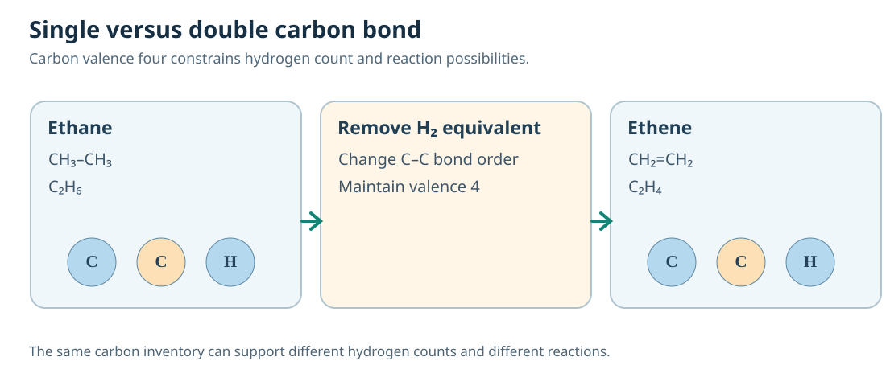

# C11 — Carbon and Organic Chemistry
## Connected Core1A Chemistry textbook · authored candidate v0.1.0

**Scope:** CBSE 2026–27 Class X Carbon and its Compounds. **Status:** DRAFT, ACADEMIC HOLD. Connections to Agent A C07 covalent bonding are declared pending canonical concept pins. The experiments and tasks are new authored pedagogy, not representations of independently verified NSEJS examination questions.

The theme of this chapter is that a molecular **formula** tells us atom inventory, a **structural formula** tells us connectivity, and experimental **behaviour** depends on both bonds and conditions. We first construct tetravalent carbon frameworks, then explain allotropes, multiple bonds, homologous series, functional groups, chemical transformations and the action of surfactants. A learner must be able to move between diagrams, chemical symbols, observed changes and causal explanations, not merely recall a table of named compounds.

---

## C11.01 — Catenation, valency and molecules

### Begin with a phenomenon

Four bonds from one carbon atom sound simple, yet they lead to enormous diversity. Why can two compounds share a molecular formula but differ in structure and behaviour?

### Understand the particles, bonds and conditions

Carbon has four valence electrons and forms stable covalent bonds with carbon and many other elements by sharing electron pairs. Tetravalency is a constraint on the sum of bond orders around a typical neutral carbon atom: four single bonds, two doubles, one triple plus a single, or other valid combinations. A structural formula must satisfy the bond count; a molecular formula records only element totals and can hide different connectivities.

Catenation means carbon can join to itself in extended chains, branches and rings. As a first model, represent methane CH₄ as a carbon with four C–H bonds, ethane C₂H₆ with a C–C single bond and three H on each carbon, then propane C₃H₈ as a continuous chain. Check each carbon's four bond orders and every hydrogen's single bond. This is not a geometric picture at scale: tetrahedral arrangement and bond angles are a more complete spatial model.

The three representation levels are atom inventory (C₂H₆), connectivity (CH₃–CH₃), and an actual three-dimensional geometry. They answer different questions. D3 asks the learner to preserve atoms and valencies when moving among them. D4 asks whether a proposed structure is possible and whether alternative isomers can satisfy the same formula without identical connections.

### Complete worked construction

Given C₄H₁₀, draw CH₃–CH₂–CH₂–CH₃ and (CH₃)₃CH. Each structure contains four carbon and ten hydrogen atoms, and each carbon has four bonds by bond-order count. They are distinct connectivity arrangements: straight-chain butane and branched 2-methylpropane. Therefore molecular formula alone does not fix the compound's unique structure. A formula-based naming shortcut misses the central evidence.

### Wrong route and conceptual repair

Wrong path: 'If the formula is C₄H₁₀, there is only one molecule with that formula.' Repair by drawing distinct valence-correct carbon graphs and checking all atom counts.

### Changed-condition / model-limit check

A proposed carbon with five ordinary single bonds is not accepted merely because the total formula matches. Check *local* valence, not only whole-molecule totals.

### Independent demand tasks

1. **REPRESENT, candidate D3** — Translate the displayed formula of CH₃–CH₂–CH₃ into a molecular formula and describe carbon valence.
2. **SYNTHESIZE, candidate D3** — Construct two valid structures for C₄H₁₀ and show how a carbon valence check excludes an impossible third sketch.
3. **JUSTIFY, candidate D3** — A claim states any connected graph with four labelled carbon vertices is chemically valid. Justify or refute using valence constraints.

---

### B02 scientific reasoning refinement

A connected acyclic saturated carbon skeleton is a tree. Each carbon has total bond order four, so H count=4−carbon degree. Each edge contributes two to degree sum. This graph-counting reasoning is an authored extension.

**Independent transfer target (REPRESENT, D4 author proposal):** Translate valence and tree-degree constraints into realizable structure.. The fresh task and worked answer remain in Core1B. Independent source and QRT review HOLD.

### B02 additional scientific foundations

Acyclic saturated graphs have degree sum 2(n−1). After choosing a branch center, arm-length multisets distinguish structures with only one branching center. Graph method is extension.

Valence and graph connectivity both constrain a carbon skeleton; count degrees before claiming feasibility. An upper bound needs a realizable example to establish a maximum. Extension model.

## C11.02 — Diamond, graphite and structural properties

### Begin with a phenomenon

Both a diamond crystal and a piece of graphite contain carbon. One is hard and electrically insulating; the other is soft and conducts along its layers. Identity alone cannot explain the contrast.

### Understand the particles, bonds and conditions

An allotrope is a structurally distinct form of an element. In diamond each carbon forms four covalent bonds in a three-dimensional network. The strong network extends through the solid, explaining exceptional hardness and a very high melting/sublimation temperature. Typical diamond lacks the freely mobile electrons needed for good ordinary electrical conduction, although special defects and doping can change detailed behaviour.

In graphite each carbon is covalently bonded to three neighbouring carbons within a sheet of hexagonal rings. Its remaining valence electrons participate in a delocalised electronic system that conducts along layers. The sheets can slip relative to one another because interlayer forces are much weaker than the in-sheet bonds, helping explain graphite's lubricating properties and flaky feel. Structural bonding, not black colour alone, is the warrant.

A useful diagram pairs local carbon coordination with macroscopic behaviour: 4 neighbours → 3D rigid network in diamond, 3 neighbours → planar sheets and delocalisation in graphite. A learner must check whether a diagram truly represents bonds and motion rather than simply making a decorative carbon lattice. Both material samples can contain impurities that modify observations.

### Complete worked construction

Suppose two carbon samples both burn to produce CO₂ under suitable complete combustion conditions, but only one conducts as a solid. The chemical combustion product supports carbon identity but does not fix allotrope. The difference in conduction is explained by the electronic structures: graphite provides delocalised charge carriers, diamond ordinarily does not. Combine this with mechanical and structural evidence to infer an allotrope without declaring a single property uniquely diagnostic.

### Wrong route and conceptual repair

Wrong path: 'If both are carbon, both must have the same hardness and conduction.' Repair using explicit 3D/2D bonding networks and delocalised charge carriers.

### Changed-condition / model-limit check

A black conducting powder is consistent with graphite but not uniquely established as pure graphite; contamination, carbon black and contact geometry require control.

### Independent demand tasks

1. **REPRESENT, candidate D3** — Represent the nearest-neighbour bonding of diamond and graphite and state a conduction implication.
2. **SYNTHESIZE, candidate D3** — Build a model explaining why graphite sheets can slide while diamond is rigid.
3. **JUSTIFY, candidate D3** — A glossy black sample conducts, but its structure has not been measured. Can that prove graphite? Justify a set of discriminating tests.

---

### B02 scientific reasoning refinement

Allotropes are distinct structures of one element. Graphite has strong in-plane bonding and weaker interlayer interactions; diamond forms a three-dimensional network. Hardness, transport and atom count are different observables, affected by defects and orientation.

**Independent transfer target (JUSTIFY, D3 author proposal):** Reject two claims using elemental composition, network and observed properties.. The fresh task and worked answer remain in Core1B. Independent source and QRT review HOLD.

### B02 additional scientific foundations

Coordination is the number of nearest bonded neighbours, not bond order or isolated bond strength. In an ideal periodic network each link is shared by two atoms; graphite has delocalised electrons in layers.

Structure–property reasoning may involve geometry, carrier paths, interlayer interaction and contact effects. A change in a single reading does not establish a phase transition or unique material identity.

## C11.03 — Saturated and unsaturated hydrocarbons

### Begin with a phenomenon

Ethane and ethene contain the same two carbon atoms, yet their hydrogen counts and typical reactions differ. What information is lost when a student simply names both 'carbon compounds'?

### Understand the particles, bonds and conditions

Saturated open-chain hydrocarbons such as ethane C₂H₆ have carbon–carbon single bonds; an unsaturated compound such as ethene C₂H₄ has a double bond, and ethyne C₂H₂ a triple bond. The different C–C bond orders change how many hydrogens can bond while each carbon maintains four bond orders. In a simple addition reaction ethene can add H₂ across its double bond to form ethane: C₂H₄ + H₂ → C₂H₆ with an appropriate catalyst.

Bromine water may lose colour when bromine reacts by addition with a suitable carbon–carbon multiple bond, but the observed loss of colour alone cannot uniquely identify an alkene. Other reducing/reactive substances can also affect bromine, and reaction conditions matter. A credible laboratory identification needs blanks and chemical context; don't generalise a familiar colour test into an absolute universal theorem.

Draw ethane as CH₃–CH₃ and ethene as CH₂=CH₂; map every carbon's bond order and each hydrogen's single bond. Then sketch how the double bond transforms during addition. At a deeper level, the transformation is not 'breaking a double bond and creating energy from nothing'; bond changes require and release energy under specific conditions, but the net reaction is represented by the balanced equation.

### Complete worked construction

A sample contains 0.10 mol of ethene and sufficient H₂ under suitable catalytic hydrogenation. Ideal complete conversion consumes 0.10 mol H₂ and forms 0.10 mol ethane. Check reactant atoms: ethene contributes C₂H₄, hydrogen adds H₂ and products total C₂H₆. If conversion is partial, the ideal stoichiometric number does not equal the observed consumption; extent of reaction must be measured.

### Wrong route and conceptual repair

Wrong path: 'Any sample that decolourises bromine must contain C=C.' Repair by distinguishing a supporting test from a unique identification and checking alternative reactive species.

### Changed-condition / model-limit check

A cyclic saturated hydrocarbon may have fewer hydrogen atoms than an open-chain alkane with the same carbon count. Molecular formula alone cannot serve as a complete unsaturation diagnosis.

### Independent demand tasks

1. **REPRESENT, candidate D3** — Represent ethane, ethene and ethyne using bonds and explain the changes in hydrogen count.
2. **SYNTHESIZE, candidate D3** — A sample decolourises bromine water. Construct two chemical explanations and an additional test rather than naming it ethene directly.
3. **JUSTIFY, candidate D3** — A student claims C₄H₈ has exactly one unsaturated structure. Refute by constructing an alkene and a saturated cyclic alternative.

---

### B02 scientific reasoning refinement

For typical neutral connected hydrocarbons, a ring or double bond reduces hydrogen count by two relative to acyclic saturation; triple reduces by four. Hydrogen-deficiency formula is extension context; formula alone does not identify structure.

**Independent transfer target (REPRESENT, D3 author proposal):** Build two valid structures and reject incompatible hydrogen count.. The fresh task and worked answer remain in Core1B. Independent source and QRT review HOLD.

### B02 additional scientific foundations

Hydrogen deficiency counts rings and multiple bonds; ideal hydrogenation consumes one H₂ per C=C and two per C≡C. Ring preservation is an explicit condition. Extension counting model, not a procedure.

One hydrogen deficiency can be a ring or a double bond. Formula constrains total atom count; reactivity depends on actual connectivity and conditions.

## C11.04 — Homologous series, isomers and naming

### Begin with a phenomenon

A series of alcohols displays similar chemical behaviour but steadily changing boiling points. Why should adding –CH₂– alter physical properties without removing the identifying functional group?

### Understand the particles, bonds and conditions

A homologous series contains compounds with the same functional group and a common general formula, whose successive members often differ by a –CH₂– unit (14 atomic mass units). For alkanes the sequence methane CH₄, ethane C₂H₆, propane C₃H₈ illustrates the CH₂ increment. Changes in size and intermolecular attractions produce gradual physical-property changes, while a shared functional group supports related chemical behaviour. 'Same formula difference' alone does not establish one series unless connectivity and functionality also agree.

Nomenclature identifies the principal carbon chain, unsaturation and substituents. In simple hydrocarbons 'meth-', 'eth-', 'prop-' and 'but-' encode carbon count, while endings such as -ane, -ene and -yne encode single, double and triple bonds in the chosen main chain. Branch positions are numbered to meet the appropriate rules. A name must be mapped back to a graph: it is not enough to memorise prefixes.

Structural isomers can share a molecular formula while differing in connectivity, as C₄H₁₀ does. That creates two separate reasoning problems: identify whether two graphs are distinct and determine whether two substances genuinely lie in the same homologous series. A learner should test both molecular formula and functional-group family before claiming systematic relatedness.

### Complete worked construction

Compare methanol CH₃OH, ethanol CH₃CH₂OH and propan-1-ol CH₃CH₂CH₂OH. Successive members differ by CH₂ while retaining the alcohol –OH group. As molecules become larger the boiling points commonly rise because dispersion interactions grow, though hydrogen bonding remains important and branching may alter the simple ordering. Do not conclude that identical functional groups imply identical measured boiling points.

### Wrong route and conceptual repair

Wrong path: 'Same molecular formula means the same compound and name.' Repair with bond graphs, valence checks and an unambiguous main-chain choice.

### Changed-condition / model-limit check

A branched isomer can have different boiling properties from a straight-chain member even though both have the same molecular mass; formula-based prediction alone is insufficient.

### Independent demand tasks

1. **REPRESENT, candidate D3** — Represent the first three straight-chain alcohols and verify their successive CH₂ differences.
2. **SYNTHESIZE, candidate D3** — Given CH₃–CH(CH₃)–CH₃, choose the systematic carbon chain and justified name.
3. **JUSTIFY, candidate D3** — A student infers two molecules of C₃H₈O must have identical chemistry. Refute by comparing a propanol with an ether isomer.

---

### B02 scientific reasoning refinement

Constitutional isomers have identical formula and different connectivity; rotations/reversed numbering are not new molecules. Enumerate via longest chain and equivalent positions. Geometric isomers require separate conditions.

**Independent transfer target (SYNTHESIZE, D3 author proposal):** Combine molar mass, systematic enumeration and symmetry.. The fresh task and worked answer remain in Core1B. Independent source and QRT review HOLD.

### B02 additional scientific foundations

Homologous alcohols share the functional group and successive members differ by CH₂; positional isomers require inequivalent sites on each carbon skeleton.

Constitutional identity depends on which atoms are bonded, not direction of drawing. An ether has C–O–C; alcohol has C–O–H. Formula alone does not establish group.

### Source-related worked bridge — authored model

Chain isomers have identical elemental formula, so their ideal complete combustion requires the same oxygen per mole despite different connectivity. Example: an acyclic alkane of molar mass 86 has 14n+2=86, so C₆H₁₄. Its complete combustion is 2C₆H₁₄+19O₂→12CO₂+14H₂O. Every C₆H₁₄ chain isomer uses 9.5 mol O₂ per mole under this model. Enumerate structures separately by longest-chain length and symmetry; oxygen demand cannot identify the individual isomer.

## C11.05 — Functional groups and the limits of molecular formula

### Begin with a phenomenon

Two clear liquids contain carbon, hydrogen and oxygen. One reacts readily with sodium hydrogen carbonate to release gas; the other does not under the same conditions. Why can a functional group be more informative than the oxygen atom count?

### Understand the particles, bonds and conditions

Functional groups are recognisable atom arrangements that frequently govern characteristic reactions. An alcohol has an –OH group bonded to carbon; a carboxylic acid contains –COOH with a carbonyl C=O and O–H within the same group. An aldehyde contains –CHO, while a ketone has a carbonyl carbon bonded to carbon groups on both sides. An ether C–O–C illustrates why 'contains oxygen' is not itself a functional-group designation.

The –OH part of an alcohol and the –OH part of a carboxylic acid do not have identical acidity. In the carboxylic acid, the resulting carboxylate ion is stabilised by delocalisation over two oxygen atoms; an ordinary alcohol does not have the same stabilization. At the Class X level, it is enough to connect structure and the characteristic acid/carbonate reaction without requiring a full resonance proof. Respect the distinction between structure-backed explanation and unsupported mechanism claims.

Represent CH₃CH₂OH as ethanol (alcohol) and CH₃COOH as ethanoic acid (carboxylic acid). The presence of a carbonyl adjacent to an O–H group is decisive. A compound with the same count of oxygen atoms can still have a different structure. D3 tasks should translate condensed and displayed formulas; D4 tasks should justify which tests discriminate the models and what remains ambiguous.

### Complete worked construction

An unlabeled sample reacts with sodium hydrogen carbonate and produces a gas that clouds limewater. A carboxylic acid functional group is consistent with the observation under appropriate conditions, but not uniquely established: mineral acid contamination could produce a similar reaction. The student should seek controlled sample identity, functional-group analysis and repeat measurements before naming ethanoic acid.

### Wrong route and conceptual repair

Wrong path: 'Every formula containing –OH is an alcohol.' Repair by identify the carbonyl adjacency and the full connectivity of the group.

### Changed-condition / model-limit check

If a liquid has formula C₂H₆O, ethanol and methoxymethane are connectivity alternatives. A formula alone does not reveal an alcohol group.

### Independent demand tasks

1. **REPRESENT, candidate D3** — Represent ethanol and ethanoic acid structurally and identify the different functional groups.
2. **SYNTHESIZE, candidate D3** — A C₂H₆O sample is called ethanol solely from its formula. Construct a countermodel and a discriminating observation.
3. **JUSTIFY, candidate D3** — A colourless liquid effervesces with carbonate, and another does not. Justify what functional-group conclusion is supported and what cannot be established.

---

### B02 scientific reasoning refinement

Functional groups are connectivity patterns influencing reaction behaviour. Identical formula can hide acid, ester or hydroxyaldehyde structures. Controlled evidence supports a class; unique identity requires independent evidence. Hydroxyaldehyde is an extension example.

**Independent transfer target (JUSTIFY, D3 author proposal):** Justify discrimination from connectivity and reaction evidence, not formula alone.. The fresh task and worked answer remain in Core1B. Independent source and QRT review HOLD.

### B02 additional scientific foundations

A single oxygen can occur in different functional groups; hydrogen deficiency may arise from C=O or C=C. Verify bond orders and atom counts independently.

An alcohol and ether can share molecular formula but differ in O–H bond and selective reaction behaviour. A calibrated structural observation plus a defined reaction model can discriminate candidates.

## C11.06 — Combustion, oxidation, addition and substitution

### Begin with a phenomenon

Why does a clean-burning gas flame become yellow and sooty when air supply is restricted? The chemical products change because conditions change, even when the fuel identity remains the same.

### Understand the particles, bonds and conditions

With sufficient oxygen, complete combustion of a hydrocarbon yields CO₂ and H₂O. For methane, CH₄ + 2O₂ → CO₂ + 2H₂O; for ethanol, C₂H₅OH + 3O₂ → 2CO₂ + 3H₂O. If oxygen is insufficient, CO and soot may form alongside CO₂ and water. Dark soot on a vessel is evidence of incomplete combustion under those conditions, not a precise measurement of which product fractions occurred.

Addition reactions place atoms across a multiple bond: C₂H₄ + H₂ → C₂H₆ in appropriate catalytic hydrogenation. Substitution replaces one atom/group with another while maintaining the framework: CH₄ + Cl₂ → CH₃Cl + HCl under suitable UV-light conditions, with possible further substitutions. The equations are net accounts; they must not be treated as complete detailed mechanisms. Reaction conditions decide which model is appropriate.

Oxidation of ethanol can form ethanoic acid with suitable oxidising reagents under appropriate conditions. In school chemistry, classify by the net change while distinguishing the reagent, products and safety controls. An exam problem may display equations for combustion, addition and substitution alongside identical molecules; the decisive reasoning is the transformation of bonds and atoms, not a label memorised by position.

### Complete worked construction

To compare methane flames under ample and restricted oxygen, first balance the ideal complete equation CH₄ + 2O₂ → CO₂ + 2H₂O. Then recognise that an oxygen-limited system cannot satisfy the ideal product assumption for every fuel molecule. Multiple incomplete pathways are possible; do not infer a unique CO:soot ratio. Independent product tests, exhaust measurements and controlled airflow are required.

### Wrong route and conceptual repair

Wrong path: 'All combustion always gives only CO₂ and water.' Repair by checking oxygen availability, fuel composition and actual products before selecting the ideal complete-combustion model.

### Changed-condition / model-limit check

A substitution reaction of methane with chlorine needs appropriate light and can continue to additional chlorinated products; a single formula does not guarantee an exclusive pure product.

### Independent demand tasks

1. **REPRESENT, candidate D3** — Represent complete methane combustion and explain why its ideal products change when oxygen is restricted.
2. **SYNTHESIZE, candidate D3** — Build two reaction routes from ethene: hydrogenation to ethane and a hypothetical combustion; justify the different reaction models.
3. **JUSTIFY, candidate D3** — A student concludes every chlorine-treated methane sample is pure CH₃Cl. Refute using reaction conditions and competing substitutions.

---

### B02 scientific reasoning refinement

Addition across C=C changes bond order and adds atoms. Complete combustion of pure hydrocarbons produces CO₂ and H₂O. Sequential conversion changes hydrogen balance without changing carbon count. The equations are theoretical, not experimental instructions.

**Independent transfer target (SYNTHESIZE, D4 author proposal):** Combine reaction network and material balances, verify independent carbon check.. The fresh task and worked answer remain in Core1B. Independent source and QRT review HOLD.

### B02 additional scientific foundations

Combustion product assumptions determine oxygen demand. Carbon and hydrogen conservation hold under both models; incomplete combustion products require evidence.

Substitution replaces H by another atom; successive net substitutions produce additional HCl. Product distribution cannot be inferred from the first balanced equation alone.

## C11.07 — Ethanol, ethanoic acid, soaps and detergents

### Begin with a phenomenon

Soap removes grease even though grease does not dissolve in plain water. Yet hard water makes ordinary soap less effective. The key is molecular architecture and the role of dissolved ions, not a memorised list of uses.

### Understand the particles, bonds and conditions

Ethanol CH₃CH₂OH is an alcohol used as a solvent and fuel; ethanoic acid CH₃COOH is a carboxylic acid found in vinegar and reacts with carbonates to release CO₂. These distinct properties follow from functional groups. Ethanoic acid and ethanol can form ethyl ethanoate and water in acid-catalysed esterification under suitable conditions: CH₃COOH + C₂H₅OH ⇌ CH₃COOC₂H₅ + H₂O. The double arrow marks a reversible reaction; a schematic equation alone does not fix the yield.

Soap molecules have a nonpolar hydrocarbon tail attracted to grease and an ionic water-interacting head. In water they can form micelles with tails toward oily dirt and hydrophilic heads outside, helping disperse grease. This is a self-assembly model whose operation depends on concentration and solution conditions. Detergents use related amphiphilic architecture but often different head-group chemistry.

Hard water contains appreciable calcium and magnesium ions. Traditional sodium/potassium carboxylate soaps can form less-soluble calcium/magnesium salts, reducing lather and producing scum. Many synthetic detergents remain useful in hard water, but their full environmental impact is not captured solely by cleaning performance. A correct comparison includes composition, conditions, dose, water quality and waste fate.

### Complete worked construction

Suppose a soap gives foam in soft water but forms scum in hard water. One model is formation of insoluble calcium carboxylate from Ca²⁺ and soap anions. Test it by adding a known Ca²⁺ concentration to a controlled soft-water sample, holding soap amount and agitation constant. If scum appears, the causal model gains support; it does not prove the precise detergent formulation or certify the wash water as environmentally safe.

### Wrong route and conceptual repair

Wrong path: 'Bubbles show complete cleaning' or 'every soap behaves identically in all water.' Repair by separating surfactant action, insoluble ion products, agitation and observed removal of grease.

### Changed-condition / model-limit check

Do not ask students to prepare esters or saponify oils with concentrated acids or bases unsupervised. Conceptual diagrams and safe teacher-supervised observations suffice.

### Independent demand tasks

1. **REPRESENT, candidate D3** — Represent a soap micelle schematically and explain why its tails and heads face different environments.
2. **SYNTHESIZE, candidate D3** — A soap works in soft water but gives scum in water rich in Ca²⁺. Choose a particle-level model and a controlled test.
3. **JUSTIFY, candidate D3** — Two transparent liquids are ethanol and ethanoic acid. One reacts with sodium hydrogen carbonate and the other forms an ester with the acid in suitable conditions. Justify a discrimination plan without using smell alone.

---

### B02 scientific reasoning refinement

Soap has ionic carboxylate heads and hydrophobic tails. Ca²⁺/Mg²⁺ can form sparingly soluble salts, removing active soap. Synthetic detergent response depends on formulation. Distinguish precipitation, micelles and foam measurements.

**Independent transfer target (SYNTHESIZE, D4 author proposal):** Combine ion stoichiometry, competing salt effects and fair experimental comparison.. The fresh task and worked answer remain in Core1B. Independent source and QRT review HOLD.

### B02 additional scientific foundations

Amphiphilic molecules contain hydrophobic tails and hydrophilic heads; aggregate geometry depends on surrounding phases. Divalent ions can remove soap through precipitation, distinct from micellisation.

Carboxylic acid can transfer proton to hydrogen carbonate. Esterification is reversible; conversion controls product amount. Distinguish functional-group evidence from purity and theoretical yield.

### Source-related worked bridge — authored model

For ethanoic acid + ethanol ⇌ ethyl ethanoate + water, the ideal stoichiometric ratio is 1:1:1:1. If 0.12 mol acid meets 0.08 mol alcohol, the theoretical maximum is 0.08 mol ester (88 g/mol), or 7.04 g. If the isolated yield is 50%, 3.52 g is collected. This does not prove only half the limiting reactant reacted: equilibrium, side reactions and isolation loss may all contribute. A material balance requires conversion and recovery separately. The example is a calculation model, not a laboratory procedure.

## What connects the seven sections?

A chemical formula is a starting constraint rather than a complete explanation. To infer behaviour, move through **bond connectivity → functional group / electron arrangement → reaction conditions → chemical products and measurable evidence**. The same hydrocarbon can combust or react in addition/substitution under different reagents. Two structural isomers can have the same total atoms but different chemical properties. For environmental or industrial choices, add a boundary and an independent check rather than treating an elegant balanced equation as proof of one exclusive outcome.

**Curriculum source:** IAPT NSEJS 2026 Class X scope; CBSE Class X Science 2026–27, Carbon and its Compounds; NCERT X Carbon and its Compounds. Scientific review, exam provenance, QRT adjudication and release: HOLD.
