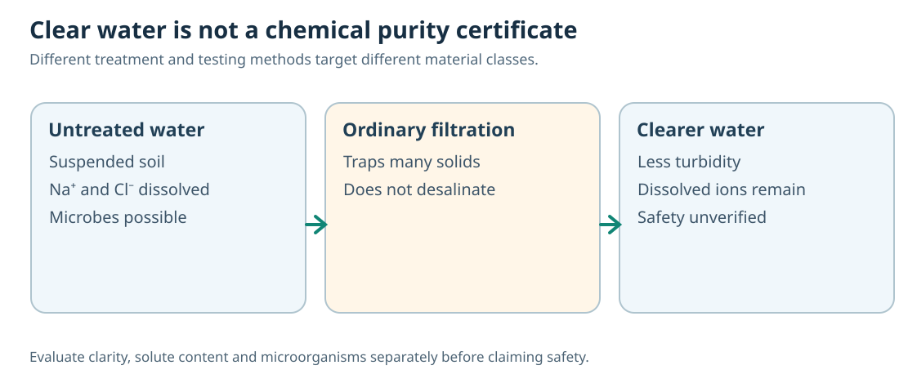

# C14 — Environmental and Applied Chemistry
## Connected Core1A textbook chapter · authored Chemistry / environmental integration

**Curriculum status:** Candidate cross-disciplinary application of Class IX–X Science, not a separately published IAPT Chemistry chapter. The scientific reasoning includes atmospheric chemistry, water, material conservation and applied decisions. **No environmental case has been authenticated as an original NSEJS source question.** Agent A C01–C02/C08–C09 prerequisites remain visible until canonical concept pins are supplied. Academic qualification: HOLD.

The chapter's central idea is that an observation is not automatically a cause. Chemical materials move between places, change chemical form and are measured by imperfect instruments. The student must name the **substance**, the **boundary**, the **pathway** and the **test that distinguishes competing explanations**. Five sections move from atmosphere through water and acidic deposition to element cycles and responsible material choices.

---

## C14.01 — Air composition, pollutants and chemical evidence

### Investigate the question

Two neighbourhood sensors report different nitrogen dioxide values even though traffic counts are nearly identical. Does that mean one sensor is defective—or that a pollutant's journey through the atmosphere matters?

### Construct the chemical explanation

Air is a mixture dominated by nitrogen and oxygen with argon, carbon dioxide, variable water vapour and many trace species. Chemical identity matters more than the vague label 'gas': molecular oxygen is essential to life, carbon dioxide participates in carbon cycling and climate, sulfur dioxide and nitrogen oxides can transform into secondary pollutants. Whether a trace constituent is a pollutant depends on concentration, exposure, context and effects; small concentration alone is not a sufficient definition.

Emissions become measured concentrations after transport, dilution, deposition and chemical reaction. Vehicle emissions can contain nitrogen oxides; sunlight and other reactive species participate in formation of ground-level ozone under suitable conditions. Ozone high in the stratosphere absorbs harmful ultraviolet radiation, while elevated ozone near the ground is a respiratory pollutant. A learner must not confuse identical molecular formula O₃ with identical environmental role independent of location.

The experimental representation should include a source, atmospheric transport, chemical conversion, concentration measurement and an exposed receptor. Weather, wind, sunlight and measurement placement matter. A correlation between traffic and high NO₂ might support a hypothesis, but it does not prove a unique source because background transport and industrial or domestic processes can contribute. Design measurements that genuinely separate alternatives.

### Stratospheric ozone depletion and two distinct atmospheric mechanisms — CHEM-FC-002

The protective stratospheric ozone layer is continuously formed and destroyed through sunlight-driven atmospheric chemistry. Its depletion means a reduction in stratospheric O₃ abundance, allowing more harmful UV-B to reach the surface; this is distinct from excess ground-level ozone pollution. Certain long-lived ozone-depleting chemicals, notably chlorofluorocarbons (CFCs) once used in some refrigeration and aerosol applications, can survive long enough to reach the stratosphere. Strong ultraviolet light breaks some CFC molecules and releases reactive chlorine atoms, which participate in repeated ozone-destroying reactions. Other ozone-depleting substances and atmospheric conditions also matter: do not infer a unique global ozone trend from one local pollution reading.

A bounded school-level catalytic model is Cl· + O₃ → ClO· + O₂ followed by ClO· + O → Cl· + O₂, yielding a net O₃ + O → 2O₂ when atomic oxygen is available. The dot denotes a reactive radical, not a negative ion. Because chlorine is regenerated, one reactive chlorine atom can participate in many cycles; real polar ozone-loss processes use additional reactions and conditions, so these two equations are an explanatory model, not a complete atmospheric simulation. A reduction in CFC emissions does not instantly rebuild the ozone layer because long-lived gases and radicals persist. Ozone depletion and greenhouse warming are distinct environmental mechanisms; neither is the same process as photochemical ground-level smog.

**Worked comparison:** A city-level monitor reports elevated surface O₃, while a vertical ozone measurement detects lower stratospheric O₃. Both findings can coexist. Compare altitude, precursor chemistry and sampling instrument; do not infer that traffic ozone and the protective ozone layer are the same environmental phenomenon.

**Native Core1B changed-condition MODEL:** C14.01's second authored cycle now compares the NOₓ/VOC surface photochemical model with the long-lived CFC/Cl· stratospheric depletion mechanism, including independent source measurements. Schematic radical equations are explanatory only, not a complete quantitative forecast.

### Complete worked evidence analysis

Sensor A near a busy road measures more NO₂ than Sensor B on a windy afternoon. To interpret it, compare sensor calibration, time intervals, wind speed/direction, road distance and background sites. A mass/concentration diagram should show that emission is a *rate at a source*, while ambient concentration is a *mixture after transport*. Observing a low concentration in one place does not imply zero emission. To test a chemical mechanism, monitor linked precursors and products rather than only the traffic count.

### Wrong inference and repair

Wrong path: 'Equal traffic means equal pollutant concentration' or 'every ozone molecule is harmful regardless of altitude.' Repair by separating production, transport, conversion and exposure conditions.

### Changed-condition or system-boundary check

A rise after a factory opens is temporal evidence, not a causal proof without comparison locations and weather controls.

### Three independent cognitive demands

1. **EXPLAIN, provisional D3** — Explain why two streets with similar traffic can have different NO₂ readings and name two controls.
2. **MODEL, provisional D3** — Choose a chemical and transport model for local NO₂ measurements versus downwind ozone changes.
3. **JUSTIFY, provisional D3** — A new factory opens and nearby pollution rises; justify why that correlation alone does not prove the factory caused the entire increase.

---

## C14.02 — Water quality, separation and actual safety

### Investigate the question

A glass of water looks clear after filtration, but its measured electrical conductivity remains high. Has the filter failed, or is the test measuring a different class of material?

### Construct the chemical explanation

Water can carry suspended particles, dissolved salts, dissolved gases and living microorganisms. Filtration through paper or sand can remove many suspended solids, but dissolved ions pass through ordinary filters. Boiling may inactivate many microbes but does not reliably remove dissolved salts; evaporation can even concentrate them. Distillation separates a volatile water fraction from many nonvolatile solutes, but it does not automatically guarantee removal of every volatile contaminant or microbial safety after collection.

Turbidity, conductivity, acidity and microbiological tests measure different features. Clear water is an aesthetic observation, not a certificate of drinking-water safety. A scientifically sound treatment design identifies the contaminant class before choosing sedimentation, filtration, adsorption, suitable disinfection, ion removal or distillation. Each process has operating limits and may introduce new risks if handled poorly.

At D3, select a sequence using particle size and chemical identity. At D4, reconcile a counterintuitive case: a filter makes water crystal-clear, but conductivity remains because dissolved salts are unchanged. A treatment strategy that removes microbial risk while concentrating nonvolatile salts might improve one quality dimension and worsen another. State the tested endpoints and sources of uncertainty rather than claiming one universal purity measure.

### Complete worked evidence analysis

Consider 500 mL water containing visible mud, dissolved NaCl and possible microbes. Allowing settling followed by ordinary filtration can lower turbidity, while conductivity remains because Na⁺ and Cl⁻ still pass through. A further ion-removal method such as appropriate reverse osmosis or distillation targets dissolved salts; disinfection addresses viable pathogens. No single visual step proves potability, and the exact treatment system must be validated for its intended use.

### Wrong inference and repair

Wrong path: 'Transparent water is chemically pure and safe to drink.' Repair with separate suspended, dissolved and microbial evidence and controls.

### Changed-condition or system-boundary check

Some dissolved toxic chemicals do not strongly affect conductivity; a low reading does not guarantee absence of contaminants.

### Three independent cognitive demands

1. **EXPLAIN, provisional D3** — Explain why an ordinary filter can make muddy water clear without decreasing conductivity caused by dissolved salt.
2. **MODEL, provisional D3** — Choose a treatment sequence for water containing suspended soil and dissolved sodium chloride, while distinguishing microbial control.
3. **JUSTIFY, provisional D3** — Two samples are equally clear, but one has high conductivity. Justify what can be inferred and what additional test is necessary before consumption.

---

## C14.03 — Combustion gases, acid deposition and causality

### Investigate the question

Rainfall near a remote mountain is acidic although there is no nearby factory. Does this disprove the idea that combustion pollutants can affect rain chemistry?

### Construct the chemical explanation

Ordinary rain is naturally somewhat acidic because atmospheric carbon dioxide dissolves and participates in weak carbonic-acid equilibria. In environmental chemistry, enhanced acidic deposition can occur when sulfur dioxide and nitrogen oxides emitted from combustion undergo atmospheric oxidation and hydration to form acidic species. The detailed reactions depend on conditions, sunlight, oxidants and droplets; a single direct equation is a simplified net model, not a full atmospheric mechanism.

Pollutants can travel considerable distances before chemical transformation and deposition. The absence of a local factory therefore does not disprove an upwind source. Conversely, acidic rain near a factory does not prove that factory is solely responsible without atmospheric data. Compare background rain acidity, wind trajectories, emission inventories, wet/dry deposition and controls at other sites.

Show an evidence path: source emission → wind transport → SOₓ/NOₓ transformation → dissolved acidity in rain → measured pH and consequences. Each arrow needs a scientific basis. Carbon dioxide's natural weak acid contribution must be separated from unusually strong acid deposition. A student's D4 task can ask which link is underdetermined from sparse observations and require a realistic discriminator, not just label 'acid rain'.

### Complete worked evidence analysis

A town measures rain pH 4.3 on one occasion. This is more acidic than typical unpolluted rain but does not identify one emission source. Investigate sulfate/nitrate chemistry in precipitation, upwind winds, nearby and regional emissions, prior weather and calibration. If the same pattern appears at remote downwind sites following high SO₂ transport, a transported-pollutant model gains support. One measurement still does not give a unique causal attribution.

### Wrong inference and repair

Wrong path: 'Any rain below pH 7 proves industrial acid rain from the nearest chimney.' Repair by accounting for natural dissolved CO₂, regional transport and multiple potential acidic species.

### Changed-condition or system-boundary check

Rain chemistry can vary over time and geography; a pH value without ionic composition and controls rarely proves one mechanism.

### Three independent cognitive demands

1. **EXPLAIN, provisional D3** — Explain why a village without factories may have sulfate-associated acidic rain.
2. **MODEL, provisional D3** — Choose a model to interpret low rain pH and elevated nitrate with shifting wind direction, distinguishing transport from local emission.
3. **JUSTIFY, provisional D3** — A village blames the nearest plant after one acidic rainfall. Refute the certainty and design an evidence-based attribution study.

---

## C14.04 — Carbon and nitrogen cycles as chemical ledgers

### Investigate the question

Carbon atoms in atmospheric carbon dioxide become part of a tree and later appear in soil or another organism. No carbon atom has been manufactured by the tree. How can a diagram show this without confusing flow with chemical reaction?

### Construct the chemical explanation

Photosynthesis transfers carbon from CO₂ into organic matter under light-driven biological chemistry; respiration, decomposition and combustion can transfer organic carbon back to CO₂. These pathways are linked through chemical transformations and physical reservoirs. The total elemental carbon in a suitably closed accounting system is conserved, although individual reservoirs rise or fall with inputs and outputs. A cycle diagram is a simplified stock-and-flow model, not a claim that all pathways have identical speed or form one direct one-step reaction.

Nitrogen chemistry is more varied. Atmospheric N₂ is abundant but often not directly accessible for plant growth; biological nitrogen fixation can convert N₂ into reduced nitrogen forms. Nitrification by suitable microbes can convert ammonium to nitrite and nitrate, while denitrification converts suitable nitrogen oxides/nitrate forms toward gaseous nitrogen species under particular conditions. Plant uptake and food webs move nitrogen into organic compounds. These transformations require distinct chemical species and environments.

At D3, learners should preserve C/N atoms across arrows and identify the missing reservoir. At D4, challenge a misleading graph that shows a reservoir gaining carbon indefinitely without an input or losing carbon without a sink. Chemical element conservation does not imply that atmospheric concentration is constant, because sources and sinks may be unbalanced over an interval.

### Complete worked evidence analysis

Imagine a lake receives 10 arbitrary carbon mass-units in dissolved inflow over a day, fixes 6 in biomass and releases 2 as CO₂. If no other transformations are given, an accounting ledger requires 2 carbon units to remain in some other pool, accumulate, leave by outflow or be explicitly marked unknown. The numbers are a teaching ledger, not a claim about real lake rates. Refusing an unexplained disappearance is the important scientific habit.

### Wrong inference and repair

Wrong path: 'A cycle diagram by itself proves a reaction rate or that the environmental system is in steady state.' Repair with separate reservoirs, flux measurements and known or unknown sinks.

### Changed-condition or system-boundary check

An ecosystem can accumulate carbon even while individual atoms are conserved; total system inventory depends on where boundaries are drawn.

### Three independent cognitive demands

1. **EXPLAIN, provisional D3** — Explain how a carbon atom can move from atmospheric CO₂ to organic matter and return without being created or destroyed.
2. **MODEL, provisional D3** — Choose a nitrogen-cycle model consistent with plant uptake of nitrate and atmospheric N₂ availability.
3. **JUSTIFY, provisional D3** — A reservoir graph shows carbon increasing with no recorded inflow. Justify what conservation demands and which measurements are missing.

---

## C14.05 — Applied decisions, lifecycle boundaries and uncertainty

### Investigate the question

One packaging material is labelled biodegradable, another recyclable. Which one is more sustainable? Without defining the environmental goal and the whole product life cycle, the question cannot be decided.

### Construct the chemical explanation

An applied chemical decision compares alternatives across defined system boundaries: raw-material extraction, manufacture, transport, use, collection, recycling/disposal and the emissions or waste from each stage. A biodegradable material can break down under suitable conditions, but degradation rates and products depend on oxygen, moisture, temperature and treatment. A recyclable material can be recovered in principle, but collection rates and recycling energy matter. Neither label alone establishes a complete environmental outcome.

Choose measurable criteria—energy consumed, greenhouse-gas emissions, water use, persistent pollutants, toxic byproducts, resource scarcity and uncertainty. Specify functional equivalence: two water treatments must deliver comparable quality before energy impacts are compared. Mixing unequal units or comparing a single production step with a whole lifecycle is a boundary error. A careful science answer states assumptions and the conditions under which its preference might reverse.

D3 tasks can build a compact decision matrix from given data; D4 tasks should identify when a seemingly green process shifts pollution to another place or changes hazard rather than eliminating it. Chemical evidence and measured values are more reliable than marketing terms. Some tradeoffs cannot be collapsed into one single universally correct ranking without stakeholder priorities; the learner should expose rather than conceal that limitation.

### Biodegradable versus non-biodegradable — CHEM-FC-013

Biodegradable and non-biodegradable describe different responses to biological decomposition, not whether an item can be recycled or whether it always has low impact. Under suitable environmental conditions, microbes and their enzymes can break many food scraps, untreated paper and plant-derived material into simpler substances; rate and final products depend on oxygen, moisture, temperature and material composition. Conventional polyethylene packaging and glass are generally non-biodegradable on ordinary environmental timescales: they are not readily mineralised by natural microbial action. Glass can be recyclable without being biodegradable. A plastic fragment becoming smaller, or a material weathering in sunlight, is not proof that microorganisms have completely broken it down.

Compare *biodegradability* (microbial transformation under specified conditions), *recyclability* (whether a recovery process exists and is used), and *environmental merit* (life-cycle outcomes). In warm aerated compost, untreated paper may break down; in a dry oxygen-limited landfill it may persist much longer. A recyclable glass container may be non-biodegradable, yet reuse and an effective collection system can change overall emissions and waste. A single advertising label cannot replace evidence of actual conditions, downstream treatment, contamination and effects; some biodegradable plastics also require industrial conditions, so do not assume disposal in any environment is safe.

**Worked two-class model:** Paper in managed compost can be biologically degraded; a conventional PE wrapper and a glass bottle are not readily biodegraded in ordinary environmental conditions. Glass can still be recyclable. Compare material chemistry, microbial action, timescale and actual disposal conditions, then use a full lifecycle boundary before claiming an environmental winner.

**Native Core1B changed-condition EXPLAIN:** The revised C14.05 first cycle requires an independent classification and a transfer from compost to dry landfill. Answers remain hidden until a first response and separate boundary attempt are recorded.

### Complete worked evidence analysis

Treatment A uses 2 energy units and removes 90% of one contaminant; treatment B uses 3 units and removes 99%. If the safety standard requires removal of at least 95%, A does not meet the common performance constraint, so comparing only energy per treatment is invalid. If both meet the required limit after an added step, the added step's energy and material impacts must enter the comparison. This is a worked example of selection under constraints, not a claim about a real plant.

### Wrong inference and repair

Wrong path: 'Biodegradable automatically means best, or the lowest-energy unit operation means lowest total impact.' Repair by defining the functional unit, performance threshold, lifecycle boundary and measured chemical waste.

### Changed-condition or system-boundary check

Changing the environmental endpoint (e.g., water contamination versus climate emissions) can reverse the preferred option. State the criterion before announcing a winner.

### Three independent cognitive demands

1. **EXPLAIN, provisional D3** — Explain why a biodegradable bag does not necessarily have lower total environmental impact than a recyclable bag.
2. **MODEL, provisional D3** — Choose between water treatments A and B when an explicit removal threshold is 95%, and explain why energy alone is insufficient.
3. **JUSTIFY, provisional D3** — A low-carbon factory advertises a new process but sends untreated waste offsite. Justify why the boundary can reverse the environmental conclusion.

---

## Chapter synthesis: evidence is not causation

Across air, water and materials, the reliable route is **species → pathway → system boundary → observation → alternative model → discriminating test**. Material conservation constrains explanations but does not identify a pollutant source. A filtered water sample can look clean while retaining dissolved hazards. Biodegradability and recycling are properties whose overall benefits depend on conditions. This is applied Chemistry, not a marketing or formula-lookup lesson.

**Scope references:** IAPT NSEJS 2026 up-to-Class-X Chemistry scope; CBSE 2026–27 Science IX/X integrated environment, natural resources and chemical processes. Per-subtopic edition review, independent Chemistry review, QRT adjudication and release: HOLD.
